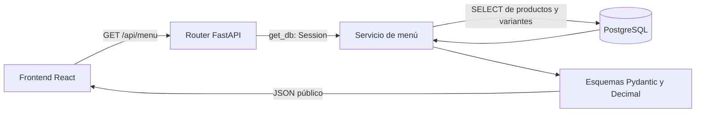

# HU-001 — Consultar menú digital: guía de estudio

Verificación final: **2 de noviembre de 2026**, zona America/Mexico_City.

**Resultado: HU-001 cumple los criterios de aceptación y el contrato está listo
para entregarse al equipo de frontend.** La suite completa terminó con
**189 pruebas aprobadas**, sin omisiones. El menú real devuelve 3 productos y
5 variantes; Hamburguesa Doble conserva su precio de **129.00 MXN**.

Esta guía reúne el funcionamiento, el contrato, las decisiones, las pruebas y
las preguntas para estudiar la historia. No requiere documentos adicionales
de presentación o defensa.

## 1. Qué implementamos

Antes, `GET /api/menu` devolvía dos productos escritos directamente en
`app/main.py`. Ahora consulta las tablas existentes `Products` y
`ProductVariants` de PostgreSQL utilizando SQLAlchemy.

El endpoint es público: no necesita usuario, contraseña, token ni cookie. Lee el
catálogo que HU-008 ya sincronizó y no consulta Loyverse. Devuelve nombres,
descripciones, IDs estables, variantes, precios y disponibilidad efectiva.

Los productos comercialmente inactivos no aparecen. Los productos activos
agotados permanecen visibles con `can_order: false`. La respuesta prepara
`image_url: null`, sin asumir que existe una tabla o columna de fotografías.

No cambiamos tablas, columnas, migraciones, sincronización ni datos comerciales
reales. El servicio del menú no inserta, actualiza, elimina ni confirma datos.

## 2. Arquitectura y flujo de consulta



1. FastAPI reconoce la ruta y obtiene una sesión mediante `Depends(get_db)`.
2. El router entrega esa sesión al servicio de menú.
3. El servicio selecciona productos con `is_active=true`, ordenados por ID.
4. `selectinload(Product.variants)` recupera sus variantes por lotes.
5. El servicio calcula `can_order`, los extremos del precio y la existencia de
   un rango. Conserva los estados almacenados por separado.
6. Pydantic valida la respuesta y convierte los importes a cadenas JSON.
7. FastAPI devuelve HTTP 200, incluso si la lista de productos está vacía.
8. La dependencia cierra la sesión al terminar. No hay `commit()` en el servicio.

Para el catálogo actual se ejecutan **dos SELECT**: uno de productos y otro de
variantes. Un catálogo público vacío necesita solamente el primero. En catálogos
muy grandes, `selectinload` puede dividir la carga de variantes en varios lotes;
no se promete que cualquier tamaño produzca exactamente dos consultas.

### Archivos y responsabilidades

| Archivo | Trabajo realizado |
| --- | --- |
| [app/main.py](../../../app/main.py) | Sustituyó el menú estático por el router, restringió CORS y conservó los valores `null` en los ejemplos de OpenAPI. |
| [app/api/menu.py](../../../app/api/menu.py) | Archivo nuevo: ruta pública, documentación y traducción de errores a HTTP. |
| [app/services/menu_service.py](../../../app/services/menu_service.py) | Archivo nuevo: consulta y reglas de presentación del catálogo. |
| [app/schemas/menu.py](../../../app/schemas/menu.py) | Archivo nuevo: contrato Pydantic, validación y serialización de importes. |
| [tests/test_menu.py](../../../tests/test_menu.py) | Archivo nuevo: 64 casos parametrizados de HU-001, incluidos PostgreSQL, OpenAPI, CORS e integración con HU-008. |
| [tests/test_migrations.py](../../../tests/test_migrations.py) | Adaptó la prueba de importación al menú real mediante una dependencia simulada; conservó sus comprobaciones importantes. |
| [docs/learning/hu001/README.md](README.md) | Esta guía final y el contrato para compartir. |

Reutilizamos sin modificar `app/db/database.py`, `Product`, `ProductVariant` y
la infraestructura de pruebas aisladas. Los modelos antiguos `Item` y `Category`
pertenecen al prototipo; su campo `image_url` no forma parte del modelo vigente.

## 3. Contrato para el equipo de frontend

**Método y URL local:** `GET http://localhost:8000/api/menu`.
El host y el puerto del backend pueden configurarse al desplegarlo; la ruta es
`/api/menu`. No recibe parámetros y no requiere autenticación.

La respuesta utiliza `Content-Type: application/json` y esta estructura:

| Campo raíz | Tipo | Significado |
| --- | --- | --- |
| `currency` | string, valor `MXN` | Moneda acordada para MITBOL. No se consulta una columna de moneda ni se realizan conversiones. |
| `products` | array de productos | Productos comercialmente activos, ordenados por `product_id`. |

### Campos de producto

| Campo | Tipo JSON | Significado |
| --- | --- | --- |
| `product_id` | integer | ID interno estable para referenciar el producto. |
| `name` | string | Nombre almacenado en PostgreSQL. |
| `description` | string o null | Descripción local; no se inventa texto cuando falta. |
| `image_url` | string o null | Actualmente siempre `null`. |
| `is_active` | boolean | Activación comercial almacenada; siempre `true` en este endpoint porque se excluyen los inactivos. |
| `is_available` | boolean | Disponibilidad local almacenada del producto. |
| `can_order` | boolean | Producto activo y disponible con al menos una variante disponible. |
| `price_min` | string o null | Menor precio del conjunto elegido para presentar el producto. |
| `price_max` | string o null | Mayor precio del mismo conjunto. |
| `has_price_range` | boolean | Indica si ambos extremos son diferentes. |
| `variants` | array de variantes | Presentaciones ordenadas por ID, incluidas las no disponibles. |

### Campos de variante

| Campo | Tipo JSON | Significado |
| --- | --- | --- |
| `product_variant_id` | integer | ID interno estable de la presentación. |
| `name` | string | Nombre almacenado. |
| `price` | string | Importe decimal exacto, sin símbolo monetario ni notación científica. |
| `is_available` | boolean | Estado almacenado de la variante. |
| `can_order` | boolean | Requiere variante disponible y producto padre activo y disponible. |

Los IDs identifican registros, no posiciones del arreglo. No deben confundirse
con los UUID de Loyverse, que el contrato público no necesita exponer.

### Interpretación de disponibilidad

```text
producto.can_order = producto.is_active
                     AND producto.is_available
                     AND existe alguna variante disponible

variante.can_order = producto.is_active
                     AND producto.is_available
                     AND variante.is_available
```

Frontend debe utilizar **`can_order` para habilitar una selección**. Una variante
puede conservar `is_available=true` y tener `can_order=false` porque el producto
padre está agotado. Este contrato informa si el catálogo permite seleccionar;
no implementa pedidos, carrito ni una reserva de inventario.

`ProductVariant` no tiene `is_active`. HU-008 utiliza `is_available=false` tanto
para ciertas bajas comerciales como para indisponibilidad local. Por eso la API
no atribuye una causa a ese estado: puede decir «No disponible», pero no asegurar
«Agotado» o «Retirado comercialmente» para una variante individual.

### Interpretación de precios

- Se utilizan exclusivamente los precios de `ProductVariants`, como `Decimal`.
- Si hay variantes disponibles, los extremos se calculan usando esas variantes.
- Si todas están no disponibles, se conservan los extremos de todas como
  referencia. El producto sigue teniendo `can_order=false`.
- Si no hay variantes, los extremos son `null` y `has_price_range=false`.
- Una sola variante o varias con el mismo precio producen un precio fijo.
- `has_price_range=true` permite mostrar «Desde» seguido de `price_min`.
- Una variante barata no disponible no reduce el precio inicial de otras que
  sí pueden seleccionarse.
- Cero es un importe válido. Un precio ausente, negativo o no finito no se
  sustituye por cero: se considera un error de integridad.

Los importes JSON son cadenas con al menos dos decimales. Ejemplos:
`"45.00"`, `"1.20"` y `"90.1234567890123456789"`. Se eliminan ceros finales que no
alteran el valor y se conservan los decimales significativos. Los cálculos
monetarios posteriores deben mantener aritmética decimal; convertir a `float`
podría perder la precisión que garantiza este contrato.

### Respuesta real verificada

La siguiente respuesta corresponde a la lectura de `mitbol_dev` del 2 de
noviembre de 2026. Es evidencia del estado observado; el catálogo puede cambiar
cuando otra operación autorizada actualice los datos.

```json
{
  "currency": "MXN",
  "products": [
    {
      "product_id": 1,
      "name": "Papas fritas",
      "description": null,
      "image_url": null,
      "is_active": true,
      "is_available": true,
      "can_order": true,
      "price_min": "45.00",
      "price_max": "45.00",
      "has_price_range": false,
      "variants": [
        {
          "product_variant_id": 1,
          "name": "Papas fritas",
          "price": "45.00",
          "is_available": true,
          "can_order": true
        }
      ]
    },
    {
      "product_id": 2,
      "name": "Limonada natural",
      "description": null,
      "image_url": null,
      "is_active": true,
      "is_available": true,
      "can_order": true,
      "price_min": "35.00",
      "price_max": "49.00",
      "has_price_range": true,
      "variants": [
        {
          "product_variant_id": 2,
          "name": "355 ml",
          "price": "35.00",
          "is_available": true,
          "can_order": true
        },
        {
          "product_variant_id": 3,
          "name": "500 ml",
          "price": "49.00",
          "is_available": true,
          "can_order": true
        }
      ]
    },
    {
      "product_id": 3,
      "name": "Hamburguesa clásica",
      "description": null,
      "image_url": null,
      "is_active": true,
      "is_available": true,
      "can_order": true,
      "price_min": "89.00",
      "price_max": "129.00",
      "has_price_range": true,
      "variants": [
        {
          "product_variant_id": 4,
          "name": "Sencilla",
          "price": "89.00",
          "is_available": true,
          "can_order": true
        },
        {
          "product_variant_id": 5,
          "name": "Doble",
          "price": "129.00",
          "is_available": true,
          "can_order": true
        }
      ]
    }
  ]
}
```

### Catálogo vacío y errores

Un catálogo sin productos activos responde **HTTP 200**:

```json
{"currency": "MXN", "products": []}
```

| HTTP | Situación | Cuerpo JSON |
| --- | --- | --- |
| `200` | Consulta correcta, con o sin productos | Contrato `MenuResponse`. |
| `503` | Fallo de conexión, interfaz o espera de SQLAlchemy | `{"detail":"El menú no está disponible temporalmente."}` |
| `500` | Error interno de consulta, validación o construcción de la respuesta | `{"detail":"No fue posible consultar el menú."}` |

Frontend debe distinguir una lista vacía de un error. Ante `503` puede ofrecer
volver a intentar; ante `500` debe mostrar el mensaje público. No necesita
interpretar mensajes SQL, servidores o credenciales. La ruta no requiere un
flujo de inicio de sesión ni devuelve `401` por ausencia de autenticación.

### CORS y origen de React

El único origen permitido actualmente es **`http://localhost:5173`**, confirmado
por el equipo. `http://127.0.0.1:5173`, `http://localhost:3000` y un dominio externo
no reciben autorización CORS. Un origen incluye protocolo, host y puerto:
`localhost` y `127.0.0.1` son orígenes distintos.

Se reemplazó `allow_origins=["*"]` por la lista explícita de un solo origen en
`app/main.py`. Se conservaron las otras opciones existentes del middleware.
El menú sigue siendo público y no exige enviar credenciales.

La prueba OPTIONS previa devuelve `200` para el origen permitido y `400` para
los demás. Una petición GET de un origen no permitido puede recibir HTTP 200
del servidor, pero sin `Access-Control-Allow-Origin`: el navegador impide que
JavaScript lea la respuesta. CORS controla la lectura desde el navegador; no
es autenticación ni impide llamadas directas con herramientas HTTP.

Si el equipo cambia host, protocolo o puerto, deberá acordarse y actualizarse
la lista explícita. No se habilitaron todos los orígenes.

## 4. Ocho fragmentos reales explicados línea por línea

Los números de las tablas cuentan las líneas de cada fragmento, no las líneas
absolutas del archivo. Los extractos corresponden al código final del repositorio.

### Fragmento 1: ciclo de vida de la sesión

Fuente: [app/db/database.py](../../../app/db/database.py), función existente
`get_db`, reutilizada sin cambios.

```python
def get_db():
    db = SessionLocal()
    try:
        yield db
    finally:
        db.close()
```

| Línea | Explicación |
| --- | --- |
| 1 | Declara la dependencia que FastAPI invoca para obtener la sesión. |
| 2 | Crea una sesión; crearla no implica ejecutar todavía una consulta. |
| 3 | Inicia un bloque que garantiza la limpieza del recurso. |
| 4 | Entrega la sesión al endpoint y pausa la dependencia. |
| 5 | Se ejecuta al terminar la petición, también si hay errores. |
| 6 | Cierra la sesión y libera sus recursos; una transacción pendiente se revierte. |

### Fragmento 2: consulta y carga anticipada

Fuente: [app/services/menu_service.py](../../../app/services/menu_service.py),
función `get_menu`, dentro de su bloque de lectura.

```python
statement = (
    select(Product)
    .where(Product.is_active.is_(True))
    .options(selectinload(Product.variants))
    .order_by(Product.product_id)
)
```

| Línea | Explicación |
| --- | --- |
| 1 | Comienza la construcción de una instrucción SQLAlchemy; todavía no ejecuta SQL. |
| 2 | Selecciona entidades del modelo vigente `Product`. |
| 3 | Excluye comercialmente inactivos mediante una condición booleana SQL. |
| 4 | Solicita que las variantes se recuperen por lotes; evita una consulta por producto. |
| 5 | Ordena de manera estable por clave primaria, sin inventar un orden comercial. |
| 6 | Cierra la expresión. Después, `db.scalars(statement).all()` ejecuta y materializa la lectura. |

### Fragmento 3: disponibilidad efectiva de variantes

Fuente: [app/services/menu_service.py](../../../app/services/menu_service.py),
función `_build_product`.

```python
parent_available = product.is_active and product.is_available
variants = [
    MenuVariant(
        product_variant_id=variant.product_variant_id,
        name=variant.name,
        price=variant.price,
        is_available=variant.is_available,
        can_order=parent_available and variant.is_available,
    )
    for variant in sorted(product.variants, key=lambda value: value.product_variant_id)
]
```

| Línea | Explicación |
| --- | --- |
| 1 | El padre debe estar activo comercialmente y disponible localmente. |
| 2 | Comienza una lista de objetos de respuesta. |
| 3 | Pydantic valida cada variante del contrato. |
| 4 | Conserva la clave primaria; no utiliza el índice del arreglo como identidad. |
| 5 | Conserva el nombre real. |
| 6 | Entrega el `Decimal` almacenado, sin convertirlo a `float`. |
| 7 | Expone el estado de la variante sin confundirlo con el del padre. |
| 8 | Calcula si la variante se puede seleccionar considerando ambos niveles. |
| 9 | Termina el objeto de respuesta de esa variante. |
| 10 | Recorre variantes ordenadas por su ID; incluye también las no disponibles. |
| 11 | Termina la lista. |

### Fragmento 4: conjunto de precios y extremos

Fuente: [app/services/menu_service.py](../../../app/services/menu_service.py),
función `_build_product`.

```python
available_variants = [variant for variant in variants if variant.is_available]
# Si todas están agotadas, los importes se conservan únicamente como referencia.
prices = [variant.price for variant in (available_variants or variants)]
price_min = min(prices, default=None)
price_max = max(prices, default=None)
```

| Línea | Explicación |
| --- | --- |
| 1 | Separa las presentaciones disponibles para calcular el precio inicial. |
| 2 | Documenta el propósito de la alternativa cuando ninguna está disponible. |
| 3 | Extrae precios del primer conjunto no vacío: disponibles o todas las variantes. |
| 4 | Calcula el mínimo con aritmética decimal; una lista vacía produce `None`. |
| 5 | Calcula el máximo usando exactamente el mismo conjunto. |

El constructor de `MenuProduct` calcula además
`has_price_range=price_min != price_max`. Si ambos son `None`, el resultado es
`false`. Su `can_order` requiere `parent_available` y una lista no vacía de
variantes disponibles.

### Fragmento 5: tipo monetario de Pydantic

Fuente: [app/schemas/menu.py](../../../app/schemas/menu.py), alias `MenuAmount`.

```python
MenuAmount = Annotated[
    Decimal,
    Field(strict=True, ge=0, allow_inf_nan=False),
    PlainSerializer(_serialize_amount, return_type=str, when_used="json"),
    WithJsonSchema(
        {"type": "string", "pattern": r"^[0-9]+\.[0-9]{2,}$",
         "examples": ["45.00", "90.1234567890123456789"]},
        mode="serialization",
    ),
]
```

| Línea | Explicación |
| --- | --- |
| 1 | Define un tipo reutilizable con metadatos de validación y serialización. |
| 2 | El valor interno sigue siendo `Decimal`. |
| 3 | En objetos Python exige Decimal, no permite negativos, infinito ni NaN. |
| 4 | Sólo al producir JSON aplica el serializador y devuelve una cadena. |
| 5 | Ajusta la documentación JSON para que coincida con la representación publicada. |
| 6 | Declara una cadena decimal sin exponente, con al menos dos cifras decimales. |
| 7 | Muestra un precio habitual y otro con precisión extensa. |
| 8 | Aplica ese esquema a la salida serializada. |
| 9 | Termina la personalización del esquema. |
| 10 | Termina el alias. |

La validación de JSON admite las cadenas decimales documentadas. La exigencia
estricta de objetos Python evita aceptar accidentalmente un `float` del ORM o
del servicio. No añadimos una escala de dos decimales al modelo SQL.

### Fragmento 6: serialización exacta

Fuente: [app/schemas/menu.py](../../../app/schemas/menu.py), función
`_serialize_amount`.

```python
def _serialize_amount(value: Decimal) -> str:
    """Sin exponentes ni redondeo, con al menos dos decimales."""
    if value.is_zero():
        return "0.00"
    whole, _, fraction = format(value, "f").partition(".")
    return f"{whole}.{fraction.rstrip('0').ljust(2, '0')}"
```

| Línea | Explicación |
| --- | --- |
| 1 | Recibe un Decimal ya validado y devuelve texto. |
| 2 | Documenta la política: no redondear ni emitir exponentes. |
| 3 | Detecta cero, incluido el cero con signo negativo. |
| 4 | Publica una representación única de cero. |
| 5 | Usa formato fijo y separa parte entera y fraccionaria sin pasar por float. |
| 6 | Quita ceros finales redundantes y agrega los necesarios para tener al menos dos decimales. |

`90.1234567890123456789` permanece exacto. No utilizamos `quantize(0.01)` porque
el esquema actual y HU-008 permiten conservar más de dos decimales.

### Fragmento 7: traducción segura a errores HTTP

Fuente: [app/api/menu.py](../../../app/api/menu.py), función del endpoint.

```python
def get_menu(db: Session = Depends(get_db)) -> MenuResponse:
    try:
        return menu_service.get_menu(db)
    except menu_service.MenuUnavailableError as error:
        # Sólo se registra el tipo: el mensaje del controlador puede contener SQL o credenciales.
        logger.warning("Menú temporalmente no disponible (%s).", type(error.__cause__).__name__)
        raise HTTPException(
            status_code=status.HTTP_503_SERVICE_UNAVAILABLE,
            detail="El menú no está disponible temporalmente.",
        ) from None
    except Exception as error:
        cause = error.__cause__ if isinstance(error, menu_service.MenuReadError) else error
        logger.error("Falló la consulta del menú (%s).", type(cause).__name__)
        raise HTTPException(
            status_code=status.HTTP_500_INTERNAL_SERVER_ERROR,
            detail="No fue posible consultar el menú.",
        ) from None
```

| Línea | Explicación |
| --- | --- |
| 1 | Declara la dependencia de sesión y el tipo de respuesta pública. |
| 2 | Establece el límite de manejo de errores del endpoint. |
| 3 | Delega consulta y reglas al servicio. |
| 4 | Captura el error de disponibilidad que el servicio construye desde SQLAlchemy. |
| 5 | Explica por qué no se registran mensajes completos del controlador. |
| 6 | Registra la clase del error original y un mensaje fijo. |
| 7 | Construye una excepción HTTP reconocida por FastAPI. |
| 8 | Utiliza HTTP 503 para indisponibilidad de la dependencia. |
| 9 | Define el mensaje fijo que frontend puede mostrar. |
| 10 | Lanza el error sin encadenamiento público de la excepción original. |
| 11 | Captura otros fallos del servicio o de construcción de la respuesta. |
| 12 | Obtiene la causa cuando el servicio ya la envolvió, sin publicar su mensaje. |
| 13 | Registra únicamente el tipo y un mensaje fijo. |
| 14 | Construye la segunda respuesta de error. |
| 15 | Utiliza HTTP 500 para errores internos. |
| 16 | Publica un mensaje estable, sin SQL ni datos de conexión. |
| 17 | Lanza la respuesta de error. |

El servicio traduce `OperationalError`, `InterfaceError` y `TimeoutError` de
SQLAlchemy a `MenuUnavailableError`; traduce otros errores SQLAlchemy y de
validación Pydantic a `MenuReadError`. El router asigna los códigos HTTP.

### Fragmento 8: prueba de consultas y N+1

Fuente: [tests/test_menu.py](../../../tests/test_menu.py), extracto de
`test_menu_loads_variants_without_n_plus_one`. Antes de este extracto la prueba
inserta 1 o 25 productos de dos variantes en una base aislada.

```python
with capture_sql(menu_db.connection) as statements:
    response = menu_client.get("/api/menu")
assert response.status_code == 200
assert len(response.json()["products"]) == product_count
selects = [sql for sql in statements if sql.lstrip().upper().startswith("SELECT")]
assert len(selects) == 2
assert '"Products"' in selects[0] and '"ProductVariants"' in selects[1]
```

| Línea | Explicación |
| --- | --- |
| 1 | Instala temporalmente un listener para capturar SQL realmente ejecutado. |
| 2 | Recorre el endpoint completo, incluidas consulta y serialización. |
| 3 | Verifica que la petición tuvo éxito. |
| 4 | Comprueba que no se omitieron productos. |
| 5 | Separa SELECT de instrucciones de control de transacciones. |
| 6 | Exige dos consultas tanto con un producto como con veinticinco. |
| 7 | Comprueba que corresponden a las dos tablas previstas. |

La prueba completa también rechaza INSERT, UPDATE, DELETE, CREATE y ALTER
durante la petición. Detecta un N+1 real: una implementación que consultara las
variantes de cada producto por separado fallaría al aumentar los productos.

## 5. Pruebas, aislamiento y resultados

### Cómo se aíslan las escrituras

Las pruebas generales del menú se parametrizan sobre SQLite en memoria y
PostgreSQL aislado. Las pruebas de precisión extensa y del error SQL real se
ejecutan específicamente en PostgreSQL, que es el motor de producción.

La fixture existente de HU-008 crea una base `mitbol_test_hu008_<id>` y aplica la
migración existente. Cada prueba obtiene una transacción exterior y sesiones
con `join_transaction_mode="create_savepoint"`. Las confirmaciones de datos
simulados quedan dentro de esa transacción y se revierten al finalizar.

La base final utilizada fue `mitbol_test_hu008_9742684eba20`. Terminó con cero
filas en las cinco tablas comerciales y se conservó: no se ejecutó DROP DATABASE.
La revisión se mantuvo en `20261029_0001`.

La prueba de integración HU-008 → HU-001 utiliza un catálogo simulado: lo
persiste mediante el servicio existente y después lo consulta por HTTP. No
descarga datos reales de Loyverse ni escribe en `mitbol_dev`.

### Cobertura de aceptación

| Criterio | Evidencia automatizada | Resultado |
| --- | --- | --- |
| Consulta pública y contrato estable | `test_menu_is_public_and_preserves_contract` | Cumple. |
| Una o varias variantes, precios distintos o iguales y cero válido | `test_single_and_multiple_variant_prices` | Cumple. |
| Precisión del almacenamiento hasta JSON | `test_postgresql_decimal_precision_reaches_json` | Cumple. |
| Formato decimal y rechazo de valores inválidos | `test_decimal_serializer_preserves_value`, `test_invalid_prices_never_become_zero` | Cumple. |
| Agotados visibles, variantes no disponibles y estados efectivos | `test_stored_availability_and_effective_can_order` | Cumple. |
| Productos inactivos excluidos | `test_commercially_inactive_products_are_excluded` | Cumple. |
| Producto sin variantes y metadatos nulos | `test_product_without_variants_or_optional_metadata` | Cumple. |
| Catálogo vacío o sólo inactivos, HTTP 200 | `test_empty_public_catalog_returns_200` | Cumple. |
| Lecturas estables sin mutación de registros | `test_repeated_reads_preserve_data_and_stable_identifiers` | Cumple. |
| Ausencia de N+1 | `test_menu_loads_variants_without_n_plus_one` | Cumple para tamaños probados, 1 y 25 productos. |
| Errores 500/503 sin filtraciones en respuesta ni registros | `test_database_errors_do_not_expose_sensitive_details`, `test_postgresql_statement_error_is_sanitized` | Cumple. |
| Swagger, ejemplos válidos y tipos de OpenAPI | `test_openapi_and_swagger_describe_public_contract` | Cumple. |
| CORS restringido al origen aprobado | `test_only_authorized_development_origin_is_allowed` | Cumple. |
| Compatibilidad con sincronización HU-008 | `test_menu_reads_catalog_written_by_hu008` y suite previa de HU-008 | Cumple. |

### Ejecución completa

Desde la raíz del repositorio:

```powershell
$env:MITBOL_POSTGRES_TESTS = '1'
$env:MITBOL_SYNC_POSTGRES_TESTS = '1'
.\.venv\Scripts\python.exe -B -m pytest -q -p no:cacheprovider
```

Se debe utilizar la configuración local autorizada de PostgreSQL. Las fixtures
comprueban `mitbol_dev` como origen y generan otra base para las escrituras.

Resultado final de esta ejecución: **189 passed, 2 warnings in 17.09s**.
Son las 125 pruebas existentes y 64 casos nuevos de HU-001. No hubo pruebas
omitidas ni fallidas. Las dos advertencias proceden de compatibilidad de
Starlette TestClient con HTTPX y del alias BlockingPortal de AnyIO; no se
cambiaron dependencias para esta historia.

La fixture histórica de HU-008 actualiza
`docs/loyverse/hu008_block2_test_database.json`. En esta verificación se guardó
su contenido original en memoria y se restauró al terminar pytest, para
conservar la evidencia histórica sin crear otro informe. El README contiene
los resultados actuales.

### Verificación real de integración

Además de pytest se ejecutó una petición HTTP mediante el transporte ASGI de
HTTPX contra la aplicación real, usando su dependencia `get_db`. Un listener
de conexión impuso `SET TRANSACTION READ ONLY` durante esta verificación.
Se comprobó `SHOW transaction_read_only = on` y `current_database() = mitbol_dev`.
Ese listener fue exclusivo del proceso de verificación; no cambia la
configuración permanente del motor.

| Comprobación real | Resultado |
| --- | --- |
| `GET /api/menu`, sin autenticación | HTTP 200. |
| Productos / variantes | 3 / 5, coincidentes con PostgreSQL. |
| Lecturas de catálogo por petición | 2 SELECT. |
| Papas fritas | 45.00 MXN. |
| Limonada natural | 35.00 y 49.00 MXN. |
| Hamburguesa clásica | Sencilla 89.00 y Doble 129.00 MXN. |
| ID de Doble | Variante 5, producto 3. |
| Campos e importes de variantes | Comparados con las filas SQL, sin diferencias. |
| `/docs` y `/openapi.json` | HTTP 200; esquemas y ejemplos válidos. |
| Origen `http://localhost:5173` | Permitido, encabezado CORS explícito. |
| Origen `http://localhost:3000` | OPTIONS 400, sin autorización CORS. |
| Esquema instalado | Revisión `20261029_0001`, sin cambios. |

Los conteos reales se mantuvieron en Products=3, ProductVariants=5,
ProductModifiers=2, ProductComplements=5 y ProductModifierAssignments=4.
También se compararon todas las filas y columnas de esas cinco tablas mediante
una huella SHA-256 de JSON canónico, ordenado por tabla y clave primaria:

```text
cb55631d9a85062a2885c103ffa1c7cbd9d4608b7b001a080a2c9b71db87b7d0
```

La huella inicial y final coinciden. Esta comparación incluye descripciones,
estados, relaciones y `synced_at`, además de conteos y precios.

## 6. Ajustes encontrados durante el Bloque 3

1. **Ejemplos de OpenAPI incompletos.** FastAPI aplica `exclude_none=True` al
   construir su documento y eliminaba `description: null` del ejemplo, aunque
   ese campo es obligatorio y nullable en el contrato. La nueva prueba lo
   detectó al validar el ejemplo. `openapi_with_menu_examples` conserva la
   generación y caché de FastAPI y repone los ejemplos directamente desde
   `MenuResponse`. No modifica la respuesta real ni duplica el contrato.
2. **Diferencia de clasificación entre motores.** Una tabla inexistente produce
   `OperationalError` en SQLite y `ProgrammingError` en PostgreSQL. La primera
   versión de la prueba esperaba 500 en ambos. La prueba de error SQL real se
   acotó a PostgreSQL, y los errores 500/503 se siguen cubriendo con fallos
   simulados independientes. No fue necesario modificar la lógica del menú.
3. **CORS demasiado amplio para la instrucción final del equipo.** Tras confirmar
   el origen React se reemplazó el comodín por `http://localhost:5173`. Se
   verificaron tanto el origen permitido como otros host, puerto y dominio.

Después de estos ajustes se volvió a ejecutar la suite completa: los 189 casos
pasaron. No se modificó la lógica de HU-008 para conseguir ese resultado.

## 7. Cómo comprobar el endpoint en Swagger

1. Abre PowerShell en la raíz del backend. La configuración `.env` local debe
   apuntar a `mitbol_dev`; no pegues credenciales en Swagger.
2. Inicia el servidor:

   ```powershell
   .\.venv\Scripts\python.exe -m uvicorn app.main:app --reload
   ```

3. Abre `http://localhost:8000/docs`.
4. Despliega **Menú → GET /api/menu**.
5. Pulsa **Try it out** y **Execute**, sin utilizar Authorize.
6. Comprueba HTTP 200, `currency: "MXN"`, los tres productos y las cinco variantes.
7. Comprueba que los precios están entre comillas, que Doble vale `"129.00"` y
   que los campos sin contenido son `null`.
8. Revisa los esquemas `MenuResponse`, `MenuProduct`, `MenuVariant` y
   `MenuErrorResponse`, además de las respuestas 500 y 503.

Swagger carga desde el propio backend, por lo que esta comprobación no prueba
por sí sola el acceso cruzado de React. Las pruebas de CORS envían explícitamente
`Origin: http://localhost:5173` y comprueban GET y OPTIONS.

Durante el trabajo se verificaron `/docs` y `/openapi.json` por HTTP; no se
automatizó un navegador pulsando los botones de Swagger. Los pasos anteriores
permiten repetir esa comprobación visual personalmente.

## 8. Conceptos técnicos, decisiones y pendientes

| Concepto o decisión | Motivo |
| --- | --- |
| Separación router / servicio / esquemas | HTTP, reglas del menú y contrato tienen responsabilidades distintas. |
| Sesión por dependencia | Permite cerrar recursos y sustituir la conexión en pruebas. |
| Endpoint síncrono `def` | Utiliza la sesión SQLAlchemy síncrona existente; FastAPI ejecuta la ruta en su grupo de hilos. |
| Activación y disponibilidad separadas | Evita confundir un producto retirado con uno agotado temporalmente. |
| `can_order` calculado | Frontend obtiene una regla consistente que contempla producto y variante. |
| `Decimal` y cadenas JSON | Conservan importes exactos y no agregan errores de coma flotante. |
| `selectinload` | Recupera variantes por lotes sin repetir una consulta por cada producto. |
| Orden por claves primarias | Mantiene resultados estables sin agregar columnas de orden. |
| `image_url: null` | Prepara el contrato sin inventar recursos ni tablas. |
| Mensajes HTTP fijos | Evita publicar detalles SQL o de infraestructura. |
| CORS con origen explícito | Permite el frontend de desarrollo confirmado sin abrir todos los orígenes. |

### Limitaciones y trabajo posterior

- No hay fotografías reales, etiquetas, categorías, filtros ni búsquedas.
- No se implementaron endpoints de detalle, carrito, pedidos ni autenticación.
- No se exponen modificadores ni complementos en este contrato de listado,
  aunque HU-008 ya almacene esas entidades.
- No puede distinguirse el motivo de indisponibilidad de una variante con el
  esquema actual. Cualquier cambio de modelo corresponderá a otra tarea.
- No se agregaron paginación, caché ni límites de catálogo. Las pruebas N+1
  verifican el comportamiento para los tamaños indicados, no una prueba de carga.
- El menú refleja el último estado almacenado por HU-008; consultarlo no inicia
  una sincronización ni confirma que Loyverse haya cambiado recientemente.
- Los IDs son estables mientras se conservan los registros de esa base; no se
  promete identidad global entre bases distintas.
- Un nuevo origen de frontend necesita acordarse y añadirse explícitamente.
- La interacción de un navegador con la aplicación React completa queda para
  la integración del equipo de frontend. El contrato HTTP y los encabezados
  CORS quedaron verificados.

Estas limitaciones no impiden completar HU-001 dentro del alcance aprobado.

## 9. Diez posibles preguntas del profesor

1. **¿Qué diferencia hay entre HU-008 y HU-001?**
   HU-008 incorpora y actualiza el catálogo comercial en PostgreSQL. HU-001
   lee ese catálogo y lo expone mediante una API pública para el menú.

2. **¿Por qué el precio pertenece a una variante?**
   Un producto puede tener varias presentaciones, cada una con identidad y
   precio propios. Un único precio en Products perdería esa información.

3. **¿Cuál es la diferencia entre `is_active`, `is_available` y `can_order`?**
   En producto, `is_active` expresa activación comercial e `is_available`
   disponibilidad local. `can_order` es un cálculo que también considera las
   variantes. En variante sólo existe `is_available`, con la limitación descrita.

4. **¿Qué ocurre si la variante más barata está agotada?**
   Si hay otras disponibles, el precio inicial usa únicamente esas otras.
   Si todas están no disponibles, sus precios quedan como referencia y el
   producto no puede seleccionarse.

5. **¿Por qué no utilizar `float` para los precios?**
   Su representación binaria puede introducir diferencias. Numeric de PostgreSQL
   y Decimal de Python permiten mantener el valor; JSON lo publica como cadena.

6. **¿Qué es N+1 y cómo demostramos que lo evitamos?**
   Es consultar productos y luego hacer una consulta de variantes por producto.
   `selectinload` carga las variantes por lotes. Las pruebas capturan SQL real y
   verifican dos SELECT tanto con 1 como con 25 productos.

7. **¿Un catálogo vacío es un error 404?**
   No. La colección existe y la consulta fue correcta, por lo que devuelve
   HTTP 200 con `products: []`. Un fallo de base de datos sí produce un error.

8. **¿Cómo se evitó modificar la base comercial al probar?**
   Las escrituras utilizaron SQLite en memoria o una base PostgreSQL generada
   para pruebas con transacciones y savepoints. La lectura real se forzó a
   sólo lectura y se comparó la huella completa del catálogo antes y después.

9. **¿CORS convierte el menú en un endpoint privado?**
   No. Autoriza al navegador del origen React acordado a leer la respuesta.
   El endpoint sigue siendo público y no exige autenticación.

10. **¿Qué sucede ante un error y qué puede ver el cliente?**
    Los fallos de disponibilidad se publican como 503 y los internos como 500,
    con mensajes fijos. No se publican consultas SQL, credenciales ni mensajes
    del controlador; las pruebas comprueban respuesta y registros.

## 10. Resumen para explicar HU-001 al equipo

HU-001 reemplaza el menú estático por `GET /api/menu`, un endpoint público que
lee PostgreSQL. Devuelve los productos comercialmente activos con sus variantes
y precios reales. Los agotados siguen visibles y frontend usa `can_order` para
habilitar una selección. Los importes se entregan como cadenas decimales exactas;
el rango permite mostrar «Desde». Las fotografías quedan en `null`.

El backend separa rutas, servicio y esquemas, carga variantes por lotes y maneja
catálogo vacío y errores sin publicar detalles internos. CORS permite únicamente
`http://localhost:5173`. La suite completa pasó 189 pruebas, HU-008 conservó su
funcionamiento y el catálogo comercial no cambió. El contrato y los ejemplos
quedan listos para que el equipo React construya la interfaz.
