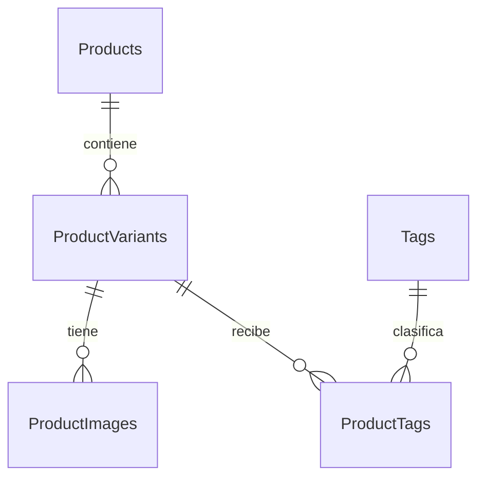

# HU-005 — Enriquecer información de productos

## 1. Objetivo, alcance y resultado

HU-005 permite completar el catálogo comercial con descripciones, fotografías y etiquetas locales. Loyverse sigue siendo la fuente de nombres, precios, variantes y modificadores. MITBOL administra el contenido que necesita el menú digital y lo conserva durante las sincronizaciones.

La historia está terminada a nivel de backend para desarrollo local. La autenticación definitiva del panel administrativo sigue pendiente. La credencial compartida de este bloque no identifica empleados ni implementa roles y no habilita una integración administrativa con React.

| Historia | Integración con HU-005 |
|---|---|
| HU-008 | Conserva la descripción y las relaciones locales; no administra imágenes ni etiquetas. |
| HU-001 | El listado público incorpora una fotografía representativa, `image_url` y etiquetas por variante. |
| HU-003 | El detalle conserva los modificadores y añade la galería de cada variante. |

La verificación final terminó con **371 pruebas aprobadas, 0 fallidas, 0 errores y 0 omitidas**. Hubo dos advertencias existentes de Starlette y AnyIO. `alembic current` mostró `20261102_0002 (head)` y `alembic check` no detectó operaciones pendientes.

Al comenzar este bloque se detectó `ADMIN_ENABLED=true` en el `.env` local. Se cambió únicamente esa variable a `false`, conservando las demás sin mostrar sus valores. La administración quedó deshabilitada. No se generaron datos de demostración en `mitbol_dev` ni se ejecutó una sincronización real de escritura.

## 2. Arquitectura y recorrido de las solicitudes

### 2.1. Archivos importantes

Los enlaces llevan a código real del repositorio.

| Archivo | Responsabilidad |
|---|---|
| [app/main.py](../../../app/main.py) | Construye la aplicación, registra errores, middleware, menú y fotografías públicas. Registra administración sólo cuando está habilitada. |
| [app/core/config.py](../../../app/core/config.py) | Variables de entorno, `SecretStr`, validación de credencial e inicio seguro. |
| [app/core/security.py](../../../app/core/security.py) | Credencial común, comparación constante, restricciones locales y límite previo al parser multipart. |
| [app/api/admin_catalog.py](../../../app/api/admin_catalog.py) | Los once endpoints administrativos y su documentación OpenAPI. |
| [app/api/media.py](../../../app/api/media.py) | Entrega imágenes registradas de productos comercialmente activos. |
| [app/api/menu.py](../../../app/api/menu.py) | Rutas públicas de HU-001 y HU-003 y errores HTTP sanitizados. |
| [app/schemas/enrichment.py](../../../app/schemas/enrichment.py) | Contratos de entrada y salida; texto plano, longitudes y campos admitidos. |
| [app/schemas/menu.py](../../../app/schemas/menu.py) | JSON público, importes exactos y estructuras de imágenes y etiquetas. |
| [app/services/product_enrichment_service.py](../../../app/services/product_enrichment_service.py) | Operaciones locales, transacciones, asociaciones y coordinación de archivos. |
| [app/services/image_storage.py](../../../app/services/image_storage.py) | Pillow, rutas seguras, UUID, diario y recuperación. |
| [app/services/enrichment_errors.py](../../../app/services/enrichment_errors.py) | Errores públicos que no revelan SQL, credenciales o rutas internas. |
| [app/services/menu_service.py](../../../app/services/menu_service.py) | Lecturas por lotes y construcción del menú, conservando las reglas comerciales. |
| [app/services/sync_service.py](../../../app/services/sync_service.py) | Persistencia comercial de HU-008; no sobrescribe el enriquecimiento. |
| [app/db/database.py](../../../app/db/database.py) | Sesión SQLAlchemy entregada mediante `get_db`. |
| [app/models/product_image.py](../../../app/models/product_image.py), [tag.py](../../../app/models/tag.py), [product_tag.py](../../../app/models/product_tag.py) | Modelos nuevos del diagrama aprobado. |
| [migración HU-005](../../../migrations/versions/20261102_0002_hu005_enrichment.py) | Crea exclusivamente las tres tablas de enriquecimiento. |
| [tests/test_enrichment_api.py](../../../tests/test_enrichment_api.py) | API, archivos, seguridad, recuperación y consultas por lotes sobre PostgreSQL aislado. |
| [tests/test_product_enrichment_models.py](../../../tests/test_product_enrichment_models.py), [test_product_enrichment_postgresql.py](../../../tests/test_product_enrichment_postgresql.py) | Diagrama, normalización, restricciones y migración incremental. |
| [tests/test_postgresql_schema.py](../../../tests/test_postgresql_schema.py), [tests/conftest.py](../../../tests/conftest.py) | Lectura del esquema real, bases aisladas, rollback y comparación de desarrollo. |
| [requirements.txt](../../../requirements.txt), [.env.example](../../../.env.example), [.gitignore](../../../.gitignore) | Dependencias, configuración documentada y exclusión de secretos y archivos locales. |

### 2.2. Recorrido de una modificación

1. La petición llega a FastAPI. Si apunta a administración, `AdminRequestGuard` comprueba primero habilitación, origen local y credencial, antes de leer el cuerpo.
2. El middleware limita el cuerpo completo a 5,000,000 + 65,536 bytes. Ese margen admite los encabezados del multipart; el archivo tiene su propio límite exacto de 5,000,000 bytes.
3. El router aplica la dependencia común de seguridad. Pydantic valida identificadores, tipos, longitudes y campos permitidos.
4. `get_db` entrega una sesión. Los servicios comprueban existencia y pertenencia de los recursos.
5. El servicio ejecuta `flush()` para enviar cambios y recibir IDs o fechas del servidor. Construye la respuesta y confirma mediante `commit()`.
6. Ante errores, `database_errors` revierte la transacción y devuelve mensajes controlados. Para fotografías también existe recuperación mediante diario.
7. El menú consulta PostgreSQL, sin llamar a Loyverse, y devuelve la información actualizada. No hay caché de respuestas del menú en esta implementación.

Los routers administran HTTP; los esquemas definen contratos; los servicios coordinan operaciones; los modelos describen persistencia. No se implementó frontend.

### 2.3. Endpoints reales

Todas las rutas administrativas requieren `X-Admin-Key` cuando están habilitadas. Deshabilitadas, devuelven `404` y no aparecen en OpenAPI.

| Método | Ruta | Entrada y respuesta correcta |
|---|---|---|
| GET | `/api/admin/products/{product_id}/description` | `200`: `product_id`, `description`. |
| PATCH | `/api/admin/products/{product_id}/description` | JSON con `description`; `200`. `null` o texto vacío limpia el campo. |
| GET | `/api/admin/variants/{variant_id}/images` | `200`: `{"images": [...]}`. |
| POST | `/api/admin/variants/{variant_id}/images` | Multipart: `file`, `display_order` opcional; `201`. |
| PATCH | `/api/admin/variants/{variant_id}/images/{image_id}` | JSON con `display_order`; `200`. |
| DELETE | `/api/admin/variants/{variant_id}/images/{image_id}` | `204`, sin cuerpo. Recurso inexistente o ajeno: `404`. |
| GET | `/api/admin/tags` | `200`: `{"tags": [...]}`. |
| POST | `/api/admin/tags` | JSON con `name`; `201`. Nombre duplicado: `409`. |
| GET | `/api/admin/variants/{variant_id}/tags` | `200`: `{"tags": [...]}`. |
| PUT | `/api/admin/variants/{variant_id}/tags/{tag_id}` | `204`, incluso si la asociación ya existía. |
| DELETE | `/api/admin/variants/{variant_id}/tags/{tag_id}` | `204`, incluso si la asociación ya estaba ausente, siempre que variante y etiqueta existan. |

Los identificadores administrativos son enteros entre 1 y 2,147,483,647. La descripción admite hasta 2,000 caracteres de entrada, rechaza HTML y controles no admitidos y elimina espacios exteriores. Los esquemas JSON de entrada prohíben campos extra: no se puede actualizar un precio mediante estas rutas.

Las respuestas de imagen contienen `product_image_id`, `product_variant_id`, `image_url`, `display_order` y `created_at`. Las etiquetas administrativas contienen `tag_id`, `name` y `created_at`. Los datos y fechas efectivos provienen de PostgreSQL; no se codifican IDs o URLs de demostración.

| Estado HTTP | Significado en HU-005 |
|---|---|
| 401 | Credencial ausente o incorrecta. |
| 403 | Cliente remoto, host/origen no permitido o cabeceras de proxy. |
| 404 | Recurso inexistente, fotografía ajena o imagen no publicada. |
| 409 | Etiqueta duplicada, otra operación de imágenes en curso o imposibilidad de agregar al final por límite entero. |
| 413 | Archivo o petición por encima del límite. |
| 415 | Contenido cuyo formato real no está admitido. |
| 422 | Validación de entrada, imagen corrupta, animación o dimensiones excesivas. |
| 500 / 503 | Error interno o indisponibilidad; sin mensajes privados de infraestructura. |

### 2.4. Almacenamiento local y publicación

La raíz se configura con `IMAGE_STORAGE_ROOT`; por defecto es `storage/product-images`. Los archivos quedan en `{product_id}/variants/{variant_id}/{uuid}.{ext}` dentro de esa raíz. La URL relativa es `/media/products/{product_id}/variants/{variant_id}/{uuid}.{ext}`.

`product_id` se obtiene de la variante registrada. Los IDs son parte de la organización del directorio; no añaden una FK directa entre `ProductImages` y `Products`. El cliente no controla carpetas ni nombres finales. Si se cambia la raíz, debe utilizarse un directorio fuera del repositorio o bajo `storage/`, que está excluido de Git.

Pillow comprueba el formato, integridad, animación y dimensiones. Después se reabre el archivo, se decodifica y se recodifica: se corrige orientación EXIF y se retiran metadatos. JPEG y WebP se guardan con calidad 90; PNG utiliza la codificación de Pillow. El resultado también debe respetar 5,000,000 bytes.

Una extensión o MIME incorrectos no determinan la aceptación. Un PNG real enviado con nombre `.exe` se guarda como PNG seguro. Un GIF renombrado `.png` se rechaza. El resultado es una imagen nueva procesada, no una copia byte a byte del original.

La raíz también contiene carpetas privadas:

| Carpeta | Contenido |
|---|---|
| `.pending` | JSON con intención, URL y UUID de operación; temporales de escritura del diario. |
| `.staging` | Archivos durante preparación de cargas. |
| `.trash` | Archivos retirados provisionalmente mientras se resuelve una eliminación. |

La API pública no monta la carpeta como un directorio estático. Busca el registro, verifica variante, producto y `is_active`, abre únicamente la ruta validada y entrega bytes con MIME fijo y `X-Content-Type-Options: nosniff`. Archivos sin registro, diarios y fotografías de productos inactivos no se publican. Las fotografías de variantes agotadas pueden seguir visibles, como sus variantes en el menú.

## 3. Base de datos y conservación comercial



| Tabla | Columnas y restricciones |
|---|---|
| `ProductImages` | `product_image_id INTEGER` PK con secuencia; `product_variant_id INTEGER` FK; `image_url TEXT`; `display_order INTEGER`; `created_at TIMESTAMP WITH TIME ZONE DEFAULT now()`. Todas `NOT NULL`. |
| `Tags` | `tag_id INTEGER` PK con secuencia; `name VARCHAR(150) UNIQUE`; `created_at TIMESTAMP WITH TIME ZONE DEFAULT now()`. Todas `NOT NULL`. |
| `ProductTags` | `product_variant_id INTEGER` FK y `tag_id INTEGER` FK. Ambas `NOT NULL` y PK compuesta, sin identificador adicional ni fecha. |

Las FK apuntan a `ProductVariants.product_variant_id` y `Tags.tag_id`. Omiten reglas especiales de actualización y borrado: PostgreSQL utiliza `NO ACTION`. Se verificó también el valor interno `a` de `pg_constraint` para las tres FK nuevas.

Las secuencias generan IDs sin calcular `MAX(id) + 1`. `DEFAULT now()` se evalúa en PostgreSQL y corresponde al inicio de la transacción; varias inserciones de una transacción pueden compartir la fecha. `TIMESTAMP WITH TIME ZONE` representa un instante; el JSON utiliza una fecha ISO 8601 con su desplazamiento horario.

El diagrama no contiene `CHECK(display_order >= 0)` ni un orden único. Esa validación pertenece a la API, que admite empates y desempata por ID. No se añadieron columnas o restricciones ajenas al diagrama.

La revisión [20261102_0002](../../../migrations/versions/20261102_0002_hu005_enrichment.py) tiene como padre `20261029_0001`. Su `upgrade()` crea sólo las tres tablas, sus restricciones y las dos secuencias implícitas de `SERIAL`. Alembic actualiza `alembic_version`. El [SQL revisado](../../database/hu005_pending.sql) conserva las operaciones aprobadas; no ejecuta `ALTER TABLE` sobre el catálogo comercial.

La migración se aplicó en la etapa anterior con autorización. En este bloque final sólo se consultó el esquema: no se volvió a aplicar ni se modificó la revisión. `downgrade()` eliminaría las tablas y sus datos; no forma parte de esta verificación y no se ejecutó sobre desarrollo.

`Products.description` ya existía. HU-008 actualiza el producto con los campos comerciales `name`, `is_active` y `synced_at`; deja fuera `description`. Las bajas comerciales cambian estados en lugar de borrar físicamente los productos y variantes. Las tablas de imágenes y etiquetas permanecen fuera de la sincronización.

El catálogo real conservó sus filas y valores, incluyendo precios, IDs, relaciones y secuencias:

| Tabla comercial | Filas antes y después |
|---|---:|
| `Products` | 3 |
| `ProductVariants` | 5 |
| `ProductModifiers` | 2 |
| `ProductComplements` | 5 |
| `ProductModifierAssignments` | 4 |

`ProductImages`, `Tags` y `ProductTags` estaban vacías y se conservaron vacías en `mitbol_dev`. Las pruebas escribieron exclusivamente en bases aisladas.

## 4. Diez fragmentos reales explicados línea por línea

Los bloques se extrajeron de las funciones existentes, sin abreviar ni inventar su contenido. La numeración de las tablas corresponde a las líneas de cada fragmento, contando sus comentarios. Cada enlace permite revisar el contexto completo.

### 4.1. Endpoint de actualización de descripción

Archivo: [app/api/admin_catalog.py](../../../app/api/admin_catalog.py), función `update_description`.

```python
@router.patch("/products/{product_id}/description", response_model=DescriptionResponse, summary="Actualizar o limpiar descripción", description="Texto plano de hasta 2,000 caracteres. null o texto vacío limpia el campo. " + ADMIN_SECURITY_DESCRIPTION)
def update_description(product_id: Identifier, payload: DescriptionUpdate, db: Database):
    return service.update_description(db, product_id, payload.description)
```

| Línea | Explicación |
|---|---|
| 1 | Registra PATCH bajo el prefijo `/api/admin`, fija la respuesta Pydantic y documenta reglas y seguridad en Swagger. |
| 2 | Recibe el ID validado, el cuerpo `DescriptionUpdate` y la sesión inyectada mediante `get_db`. |
| 3 | Delega la operación al servicio y devuelve su resultado; el router no contiene SQL. |

Decisión: separar HTTP de persistencia permite probar cada responsabilidad y mantener una API consistente. Concepto: enrutamiento REST, validación y dependencias de FastAPI. La dependencia administrativa está declarada para todo el router.

### 4.2. Actualización transaccional de la descripción

Archivo: [app/services/product_enrichment_service.py](../../../app/services/product_enrichment_service.py), función `update_description`.

```python
def update_description(db, product_id, description):
    with database_errors(db):
        product = require_product(db, product_id)
        product.description = description
        db.flush()
        result = DescriptionResponse.model_validate(product)
        db.commit()
        return result
```

| Línea | Explicación |
|---|---|
| 1 | Define la operación de negocio sobre una sesión recibida. |
| 2 | Activa traducción de errores y rollback mediante el administrador de contexto común. |
| 3 | Carga el producto o genera un error público 404. |
| 4 | Cambia sólo el campo local; el valor puede ser `None` para limpiarlo. |
| 5 | Envía el UPDATE a PostgreSQL dentro de la transacción. |
| 6 | Construye una respuesta independiente del estado posterior de la sesión ORM. |
| 7 | Confirma la transacción. Si falla, el contexto intenta revertirla y traduce el error. |
| 8 | Devuelve el contrato validado después de confirmar. |

Decisión: modificar exclusivamente `description` conserva las reglas y campos comerciales. Concepto: unidad de trabajo ORM; `flush()` no equivale a `commit()`.

### 4.3. Validación y recodificación de una fotografía

Archivo: [app/services/image_storage.py](../../../app/services/image_storage.py), función `validate_image`.

```python
def validate_image(data: bytes) -> tuple[bytes, str]:
    if len(data) > MAX_IMAGE_BYTES:
        raise EnrichmentError(413, "La imagen supera el límite de 5 MB (5,000,000 bytes).")
    if not data:
        raise EnrichmentError(422, "La imagen está vacía.")
    try:
        with warnings.catch_warnings():
            warnings.simplefilter("error", Image.DecompressionBombWarning)
            with Image.open(BytesIO(data)) as source:
                format_name = source.format
                if format_name not in {"JPEG", "PNG", "WEBP"}:
                    raise EnrichmentError(415, "Sólo se admiten imágenes JPEG, PNG y WebP.")
                if source.width * source.height > MAX_IMAGE_PIXELS or getattr(source, "n_frames", 1) != 1:
                    raise EnrichmentError(422, "La imagen debe ser estática y tener como máximo 20 megapíxeles.")
                source.verify()
            with Image.open(BytesIO(data)) as source:
                source.load()
                image = ImageOps.exif_transpose(source)
                image = image.convert("RGB" if format_name == "JPEG" else "RGBA")
                image.info.clear()
                output = BytesIO()
                image.save(output, format=format_name, **({"quality": 90} if format_name != "PNG" else {}))
                processed = output.getvalue()
                if len(processed) > MAX_IMAGE_BYTES:
                    raise EnrichmentError(413, "La imagen procesada supera el límite de 5 MB.")
                return processed, {"JPEG": "jpg", "PNG": "png", "WEBP": "webp"}[format_name]
    except EnrichmentError:
        raise
    except UnidentifiedImageError:
        recognized = data.startswith((b"\xff\xd8", b"\x89PNG")) or data[:4] == b"RIFF"
        raise EnrichmentError(422 if recognized else 415, "El archivo no contiene una imagen válida admitida.") from None
    except (OSError, ValueError, SyntaxError, Image.DecompressionBombError, Image.DecompressionBombWarning):
        raise EnrichmentError(422, "La imagen está dañada o excede los límites admitidos.") from None
```

| Línea | Explicación |
|---|---|
| 1 | Recibe bytes y devuelve bytes procesados junto con una extensión controlada. |
| 2 | Compara el tamaño real con el límite de 5,000,000 bytes. |
| 3 | Rechaza el exceso con 413; el valor exacto del límite sí se permite. |
| 4 | Detecta un archivo sin contenido. |
| 5 | Devuelve 422 para ese archivo vacío. |
| 6 | Comienza el manejo controlado de errores de imagen. |
| 7 | Limita el alcance de la configuración de advertencias de Pillow. |
| 8 | Convierte avisos de descompresión peligrosa en errores tratables. |
| 9 | Abre los bytes en memoria; no utiliza la extensión aportada por el cliente. |
| 10 | Obtiene el formato identificado por Pillow. |
| 11 | Aplica la lista de formatos permitidos. |
| 12 | Rechaza otros formatos con 415. |
| 13 | Comprueba el total de píxeles y que no existan varios cuadros. |
| 14 | Rechaza exceso de dimensiones o animación mediante 422. |
| 15 | Comprueba integridad con `verify()`. |
| 16 | Reabre la imagen porque la verificación anterior no sustituye su decodificación. |
| 17 | Fuerza la carga completa de los píxeles y detecta errores de decodificación. |
| 18 | Aplica la orientación EXIF para evitar fotografías giradas. |
| 19 | Normaliza el modo: RGB para JPEG, RGBA para PNG y WebP. |
| 20 | Retira metadatos adicionales. |
| 21 | Prepara un buffer de salida. |
| 22 | Codifica una imagen nueva; JPEG y WebP utilizan calidad 90. |
| 23 | Obtiene el resultado procesado. |
| 24 | Comprueba también el tamaño de la nueva codificación. |
| 25 | Rechaza un resultado procesado demasiado grande con 413. |
| 26 | Devuelve sólo una de las extensiones admitidas y los bytes saneados. |
| 27 | Identifica errores de negocio ya clasificados. |
| 28 | Los conserva sin sustituir su estado HTTP. |
| 29 | Trata los archivos que Pillow no puede identificar. |
| 30 | Reconoce algunas firmas para distinguir contenido aparentemente corrupto de formatos no admitidos; esto no reemplaza la validación de Pillow. |
| 31 | Emite 422 o 415 con un mensaje público, sin incluir la excepción interna. |
| 32 | Captura fallos de lectura, estructura o descompresión del archivo. |
| 33 | Los convierte en 422 sin revelar información interna. |

Decisión: un nombre `.jpg` o un MIME declarado no prueban el contenido. Decodificar y recodificar impide publicar sin revisión los bytes originales. Conceptos: validación de archivos, defensa por límites y separación entre formato declarado y real.

### 4.4. Comprobación del directorio permitido

Archivo: [app/services/image_storage.py](../../../app/services/image_storage.py), método `LocalImageStorage._inside`.

```python
def _inside(self, *parts: str) -> Path:
    path = self.root.joinpath(*parts)
    if not path.resolve().is_relative_to(self.root):
        raise StorageError()
    return path
```

| Línea | Explicación |
|---|---|
| 1 | Recibe segmentos para formar una ruta interna. |
| 2 | Los une a la raíz configurada por el backend. |
| 3 | Resuelve la ruta y comprueba que siga dentro de la raíz. |
| 4 | Rechaza rutas fuera del directorio permitido con un error sanitizado. |
| 5 | Devuelve la ruta permitida. |

Decisión: complementar los UUID y el patrón estricto de URL con una comprobación de pertenencia. Concepto: prevención de traversal. La raíz pertenece a configuración confiable; no se recibe de una petición.

### 4.5. Preparación de una carga y registro previo de intención

Archivo: [app/services/image_storage.py](../../../app/services/image_storage.py), método `LocalImageStorage.prepare_create`.

```python
def prepare_create(self, content: bytes, extension: str, product_id: int, variant_id: int) -> FileOperation:
    if extension not in {"jpg", "png", "webp"}:
        raise StorageError()
    operation = FileOperation("create", f"/media/products/{product_id}/variants/{variant_id}/{uuid4().hex}.{extension}")
    final, staging, _, _ = self._paths(operation)
    self._record(operation)  # El diario se escribe antes de crear el archivo.
    self._write_file(staging, content)
    final.parent.mkdir(parents=True, exist_ok=True)
    os.replace(staging, final)
    return operation
```

| Línea | Explicación |
|---|---|
| 1 | Recibe la imagen ya procesada y los IDs obtenidos del catálogo. |
| 2 | Revalida que la extensión sea una de las controladas por el servidor. |
| 3 | Impide construir una operación para una extensión no admitida. |
| 4 | Genera un UUID para el nombre público y crea la intención de carga. El identificador del diario es otro UUID. |
| 5 | Calcula las rutas final y temporal, sin aceptar carpetas del cliente. |
| 6 | Escribe el diario antes de escribir la imagen, para que una interrupción pueda rastrearse. |
| 7 | Escribe y sincroniza el archivo temporal con `_write_file`. |
| 8 | Crea los directorios finales necesarios. |
| 9 | Publica el archivo mediante un renombrado en el mismo sistema de archivos. Todavía necesita su registro SQL para ser accesible por la API. |
| 10 | Entrega la operación al servicio, que persistirá la referencia y confirmará. |

Decisión: una intención duradera permite distinguir un archivo preparado de una carga confirmada. Conceptos: UUID, publicación por renombrado y coordinación de recursos sin transacción distribuida.

### 4.6. Eliminación con recuperación

Archivo: [app/services/product_enrichment_service.py](../../../app/services/product_enrichment_service.py), función `delete_image`.

```python
def delete_image(db, storage: LocalImageStorage, variant_id, image_id):
    with database_errors(db):
        _storage_lock(db)
        storage.recover(db)
        image = require_image(db, variant_id, image_id)
        try:
            # Si otra fila referencia la misma URL, conserva el archivo compartido.
            shared = db.scalar(select(func.count()).select_from(ProductImage).where(
                ProductImage.image_url == image.image_url,
            )) > 1
            operation = None if shared else storage.prepare_delete(image.image_url)
            db.delete(image)
            db.flush()
            db.commit()
        except Exception:
            _recover_failed(db, storage)
            raise
        if operation is not None:
            _finalize(storage, operation, False)
```

| Línea | Explicación |
|---|---|
| 1 | Define la eliminación de una imagen de una variante específica. |
| 2 | Aplica rollback y traducción común de errores. |
| 3 | Adquiere un bloqueo asesor transaccional de PostgreSQL para las operaciones de imágenes. |
| 4 | Resuelve operaciones pendientes antes de comenzar una nueva mutación. |
| 5 | Exige que la imagen pertenezca a la variante y bloquea su fila. |
| 6 | Inicia el tramo que necesita compensación ante fallos. |
| 7 | Documenta que no se debe borrar un archivo aún compartido por otra referencia. |
| 8 | Comienza una consulta que cuenta referencias a la URL. |
| 9 | Restringe el conteo a la misma imagen física. |
| 10 | Considera compartida una URL con más de una fila. |
| 11 | Para una referencia exclusiva, registra la eliminación y mueve el archivo a `.trash`; si está compartida, conserva el archivo. |
| 12 | Marca la fila para eliminarla. |
| 13 | Envía la eliminación a PostgreSQL sin confirmar todavía. |
| 14 | Confirma el borrado del registro. |
| 15 | Intercepta fallos de preparación, escritura o confirmación. |
| 16 | `_recover_failed` revierte y consulta el estado real para restaurar o limpiar archivos, si puede adquirir el bloqueo. |
| 17 | Propaga el fallo al traductor de errores. |
| 18 | Verifica que haya una operación física pendiente de finalizar. |
| 19 | Intenta retirar archivo y diario después del commit. Si falla la limpieza, queda registrada para reintentar. |

Decisión: PostgreSQL y disco no comparten una transacción. `settle()` consulta la existencia de la referencia durante recuperación: conserva o restaura una imagen referenciada y retira archivos sin referencia. Conceptos: compensación, commit incierto y recuperación idempotente.

La limpieza posterior a un commit puede fallar y aun así la eliminación lógica devolver 204. El archivo pendiente permanece privado y registrado. Se reintenta en la siguiente carga o eliminación autorizada; no hay un proceso periódico ni una promesa de recuperación automática ante pérdida física del disco.

### 4.7. Normalización de nombres de etiquetas

Archivo: [app/models/tag.py](../../../app/models/tag.py), método `Tag.normalize_name`.

```python
@validates("name")
def normalize_name(self, key: str, value: str) -> str:
    if not isinstance(value, str):
        raise ValueError("El nombre de la etiqueta debe ser texto.")
    name = normalize("NFC", " ".join(value.split()).casefold())
    if not name or len(name) > 150:
        raise ValueError("El nombre normalizado debe tener entre 1 y 150 caracteres.")
    return name
```

| Línea | Explicación |
|---|---|
| 1 | Registra un validador ORM para asignaciones de `name`. |
| 2 | Recibe el atributo y el valor propuesto. |
| 3 | Comprueba que el valor sea texto. |
| 4 | Rechaza otros tipos antes de persistir. |
| 5 | Normaliza espacios, aplica comparación Unicode sin mayúsculas mediante `casefold()` y compone Unicode con NFC. |
| 6 | Comprueba la longitud del valor ya normalizado. |
| 7 | Rechaza nombres vacíos o mayores de 150 caracteres. |
| 8 | Devuelve el nombre canónico que se guardará. |

`TagCreate` reutiliza esta normalización y también exige texto plano. El servicio `create_tag` construye `Tag(name=name)`, añade el objeto, hace `flush()` y confirma. Una colisión con `UNIQUE(name)` se convierte en 409.

Decisión: guardar una forma canónica permite que la unicidad aprobada resuelva también dos creaciones equivalentes. Conceptos: normalización y restricciones concurrentes. Ejemplos semánticos: ` PICANTE ` y `picante` producen el mismo nombre; `CAFE` más acento combinante produce `café`. Las tildes no se eliminan.

Las inserciones directas por SQL o SQLAlchemy Core eluden `@validates`. PostgreSQL garantiza la unicidad exacta del valor almacenado, no toda la normalización de la aplicación. Las futuras operaciones de escritura deben reutilizar el mismo camino validado.

### 4.8. Asociación idempotente

Archivo: [app/services/product_enrichment_service.py](../../../app/services/product_enrichment_service.py), función `associate_tag`.

```python
def associate_tag(db, variant_id, tag_id):
    with database_errors(db):
        require_variant(db, variant_id)
        require_tag(db, tag_id)
        db.execute(insert(ProductTag).values(
            product_variant_id=variant_id, tag_id=tag_id,
        ).on_conflict_do_nothing(index_elements=["product_variant_id", "tag_id"]))
        db.commit()
```

| Línea | Explicación |
|---|---|
| 1 | Recibe los dos IDs que identifican la asociación. |
| 2 | Prepara el manejo transaccional de errores. |
| 3 | Exige una variante existente. |
| 4 | Exige una etiqueta existente. |
| 5 | Construye un INSERT de PostgreSQL sobre `ProductTags`. |
| 6 | Asigna la pareja de claves foráneas. |
| 7 | Si ya existe esa PK compuesta, no inserta otra fila ni genera un error por duplicado. |
| 8 | Confirma la operación. |

Decisión: la base resuelve el conflicto de manera atómica. Un SELECT previo seguido de INSERT no sería suficiente contra carreras concurrentes. Conceptos: PK compuesta, `ON CONFLICT DO NOTHING` e idempotencia. Repetir PUT deja el mismo estado y devuelve 204.

### 4.9. Dependencia de seguridad administrativa

Archivo: [app/core/security.py](../../../app/core/security.py), función `require_local_admin`.

```python
def require_local_admin(
    request: Request, key: Annotated[str | None, Security(admin_header)],
) -> None:
    config = request.app.state.settings
    if not config.admin_enabled:
        raise HTTPException(404, "Recurso no encontrado.")
    if not local_admin_request(request):
        raise HTTPException(403, "La administración sólo admite acceso backend local.")
    if not valid_admin_key(config, key):
        raise HTTPException(401, "Credencial administrativa inválida.")
```

| Línea | Explicación |
|---|---|
| 1 | Define una dependencia reutilizable para las rutas administrativas. |
| 2 | Recibe la petición y la clave extraída mediante `Security(APIKeyHeader)`, que también documenta Swagger. |
| 3 | Indica que no devuelve un usuario o rol ficticio. |
| 4 | Recupera la configuración de esa instancia de la aplicación. |
| 5 | Comprueba la habilitación explícita. |
| 6 | Devuelve 404 si administración está apagada. |
| 7 | Comprueba cliente loopback, host permitido, origen y ausencia de cabeceras de proxy. |
| 8 | Rechaza acceso fuera de ese contexto con 403. |
| 9 | Delega la comparación de la credencial configurada. |
| 10 | Rechaza credencial ausente o incorrecta con 401. |

`valid_admin_key` utiliza `secrets.compare_digest` sobre bytes, sin registrar valores. `Settings` requiere 32–128 caracteres URL-safe y una credencial distinta de Loyverse cuando la administración se habilita. `hide_input_in_errors=True` evita mostrar entradas de configuración en los mensajes de validación.

El middleware repite el control antes del parser multipart y limita bytes; la dependencia expresa la seguridad del router y de OpenAPI. La aplicación no registra esas rutas por defecto. Conceptos: defensa por capas, validación de configuración y diferencia entre acreditar una clave compartida e identificar a una persona.

### 4.10. Integración pública sin N+1

Archivo: [app/services/menu_service.py](../../../app/services/menu_service.py), función `_load_enrichment`.

```python
def _load_enrichment(db: Session, products: list[Product]) -> tuple[dict, dict]:
    identifiers = [variant.product_variant_id for product in products for variant in product.variants]
    images, tags = {}, {}
    # Lotes acotados: evita parámetros ilimitados y mantiene las consultas independientes
    # del número de variantes dentro de cada lote, igual que selectinload.
    for offset in range(0, len(identifiers), 500):
        batch = identifiers[offset:offset + 500]
        for image in db.scalars(select(ProductImage).where(
            ProductImage.product_variant_id.in_(batch),
        ).order_by(ProductImage.display_order, ProductImage.product_image_id)):
            images.setdefault(image.product_variant_id, []).append(image)
        for variant_id, tag in db.execute(select(ProductTag.product_variant_id, Tag).join(
            Tag, Tag.tag_id == ProductTag.tag_id,
        ).where(ProductTag.product_variant_id.in_(batch)).order_by(Tag.tag_id)):
            tags.setdefault(variant_id, []).append(MenuTag.model_validate(tag))
    return images, tags
```

| Línea | Explicación |
|---|---|
| 1 | Devuelve dos mapas de enriquecimiento para productos ya cargados. |
| 2 | Obtiene los IDs de sus variantes cargadas por `selectinload`. |
| 3 | Prepara los mapas de imágenes y etiquetas. |
| 4 | Explica por qué el número de parámetros de una consulta debe acotarse. |
| 5 | Relaciona esa estrategia con la carga anticipada existente. |
| 6 | Recorre ventanas de hasta 500 variantes. |
| 7 | Obtiene los IDs del lote actual. |
| 8 | Prepara la consulta de imágenes. |
| 9 | Restringe la consulta a todas las variantes de ese lote a la vez. |
| 10 | Ordena fotografías por `display_order` y después por ID. |
| 11 | Agrupa los resultados por variante, en memoria y sin nuevas consultas. |
| 12 | Selecciona el ID de variante y la etiqueta relacionada en una sola consulta. |
| 13 | Define el JOIN por `tag_id`. |
| 14 | Limita al lote y ordena etiquetas por ID. |
| 15 | Convierte cada etiqueta al contrato público y la agrupa por variante. |
| 16 | Devuelve los mapas para construir listado y detalle. |

Decisión: consultar colecciones por lotes evita una consulta adicional por variante. Conceptos: carga anticipada, JOIN y N+1. Con los escenarios pequeños se midieron cuatro SELECT para listado y seis para detalle. Al superar 500 variantes aumentan por lote, no por cada variante.

La imagen representativa del producto se elige por `(display_order, product_variant_id, product_image_id)`. Cada variante utiliza su primera imagen y conserva sólo sus propias etiquetas. El detalle incluye su galería ordenada. Sin datos se devuelve `image_url: null`, `tags: []` e `images: []` donde corresponda.

## 5. Conceptos fundamentales y decisiones

| Concepto | Explicación aplicada a MITBOL |
|---|---|
| API REST | Recursos identificados por rutas y operaciones HTTP: GET consulta, POST crea, PATCH modifica campos y PUT/DELETE administran asociaciones. |
| Modelo ORM | Clase Python que mapea columnas, claves y relaciones. Un objeto `Tag` puede representar una fila de `Tags`. |
| Migración Alembic | Cambio de esquema versionado y revisable. Importar FastAPI no ejecuta `create_all` sobre desarrollo. |
| PK | Identifica una fila sin duplicados: `product_image_id` o `tag_id`. |
| FK | Exige que la variante o etiqueta referenciada exista. Evita referencias huérfanas en PostgreSQL. |
| PK compuesta | La pareja `(product_variant_id, tag_id)` identifica una asociación; ninguna columna necesita ser única individualmente. |
| Transacción | Agrupa cambios SQL que se confirman o revierten. Un archivo en disco necesita coordinación adicional. |
| Idempotencia | Repetir una operación deja el mismo estado. Asociar o retirar una etiqueta tiene ese comportamiento; repetir POST de creación no implica idempotencia. |
| `ON CONFLICT DO NOTHING` | PostgreSQL ignora la inserción cuando la pareja ya existe, manteniendo la PK como garantía. |
| Autenticación | Comprobar una credencial. Aquí sólo se acredita posesión de una clave compartida, sin identificar al empleado. |
| Autorización | Decidir qué operaciones puede realizar un sujeto. El módulo definitivo por cuentas y permisos queda pendiente. |
| Validación de archivos | Comprobar bytes, decodificación, formato, dimensiones y tamaño; no confiar sólo en el nombre o MIME. |
| `multipart/form-data` | Formato que permite enviar archivo y `display_order` en una misma petición. Esa carga no es un cuerpo JSON. |
| UUID | Identificador generado por el servidor para nombres impredecibles y para distinguir operaciones de recuperación. No sustituye controles de publicación. |
| N+1 | Consultar una colección y luego hacer otra consulta por elemento. Aquí se sustituyó por lotes y JOIN. |
| `Decimal` | Representación decimal exacta. Los importes del menú se serializan como cadenas, sin pasar a `float` ni redondear. |
| Persistencia local y sincronización | Cada sistema conserva sus campos: Loyverse actualiza lo comercial; MITBOL conserva contenido local. |
| CORS | Regla del navegador para acceso entre orígenes; no protege una API frente a clientes HTTP directos. |
| Compensación | Acción que repara un efecto de disco cuando falla una transacción SQL o cuyo resultado resulta incierto. |

El menú conserva precios, variantes, grupos, complementos, disponibilidad y `can_order`. La variante debe estar disponible y su producto activo y disponible; un complemento necesita además estar activo. HU-005 no redefine esas reglas, no suma complementos al rango y no transforma importes a flotantes.

## 6. Verificación final y evidencia

### 6.1. Comandos realmente ejecutados

Desde la raíz del repositorio en PowerShell:

```powershell
$env:MITBOL_POSTGRES_TESTS = '1'
$env:MITBOL_SYNC_POSTGRES_TESTS = '1'
$reportPath = Join-Path $env:TEMP 'mitbol-hu005-final-pytest.xml'
.\.venv\Scripts\python.exe -B -m pytest -q -p no:cacheprovider --junitxml $reportPath --maxfail=3
```

| Resultado final | Cantidad |
|---|---:|
| Aprobadas | 371 |
| Fallidas | 0 |
| Errores de ejecución/fixtures | 0 |
| Omitidas | 0 |
| Advertencias | 2 |

La ejecución anterior del Bloque 2 tenía 357 casos. Este bloque añadió 14 casos límite. Los comandos desactivan la caché de pytest y la escritura de bytecode. Las pruebas de persistencia nuevas usan PostgreSQL aislado; se conservaron las pruebas históricas que también cubren SQLite en memoria.

Las dos advertencias son `StarletteDeprecationWarning` por el uso de httpx con `TestClient` y `DeprecationWarning` por el alias `anyio.abc.BlockingPortal`. No se ocultaron ni se sustituyeron dependencias ajenas a HU-005 para eliminarlas. `pip check` indicó `No broken requirements found.`

### 6.2. Casos comprobados

| Grupo | Evidencia automatizada |
|---|---|
| Descripción | GET, PATCH, `null`, espacios, texto de 2,000 caracteres aceptado, 2,001 rechazado, HTML/controles/campos extra rechazados e IDs inexistentes. Listado y detalle reflejan los cambios. |
| Fotografías | JPEG, PNG y WebP reales; MIME y nombre no confiables; UUID; orden, pertenencia y borrado. |
| Límites exactos | Archivo válido de 5,000,000 bytes aceptado y 5,000,001 rechazado. El multipart no se cuenta como parte del archivo. Imagen de 20,000,000 píxeles aceptada y cabecera superior rechazada antes de descomprimir. |
| Contenido inválido | PNG, JPEG y WebP corruptos; GIF y SVG rechazados; imágenes animadas rechazadas; metadatos JPEG retirados. |
| Recuperación | Fallos de escritura del diario, staging, publicación, commit, movimiento de borrado y limpieza; commit incierto; operaciones pendientes recuperadas y diarios independientes. |
| Publicación | Acceso sin clave a imágenes registradas de productos activos; archivos inexistentes, privados, sin registro o de productos inactivos devuelven 404. |
| Etiquetas | Nombres normalizados, longitud, Unicode, duplicados, GET, asociación repetida y retirada repetida, sin duplicar la PK compuesta. |
| Seguridad | Once operaciones sin credencial bloqueadas antes de acceder a la base, claves incorrectas, clientes remotos, origen React, Host y cabeceras Forwarded/X-Forwarded-* rechazados. Configuraciones inválidas impiden arrancar. |
| Secretos | Credencial de prueba ausente de respuestas y logs en rechazos y fallos autenticados. Configuración oculta entradas en errores; no se hallaron claves reales en archivos no ignorados. |
| PostgreSQL | Tipos, nulabilidad, PK, FK, unicidad, fechas, secuencias, `NO ACTION` y ausencia de diferencias ORM/esquema. |
| HU-008 | Descarga simulada y persistencia, actualizaciones, idempotencia, bajas y conservación de contenido local. |
| HU-001 y HU-003 | Contratos aditivos, `Decimal`, modificadores, complementos, disponibilidad y `can_order`, casos vacíos y errores sanitizados. |
| N+1 | Con 1 y 25 variantes adicionales: 4 SELECT para listado y 6 para detalle. Con 501 adicionales: 6 y 9, respectivamente, al cruzar ventanas de 500. |

El archivo exacto de 5 MB se construyó con un PNG válido y relleno posterior a IEND: Pillow lo acepta y recodifica sin conservar ese relleno. La prueba demuestra el límite de entrada, no que el archivo de salida deba conservar 5 MB.

### 6.3. Aislamiento y estado de desarrollo

La fixture genera nombres `mitbol_test_hu008_<uuid>` porque reutiliza la infraestructura y las comprobaciones de destino de HU-008. Aplica migraciones a esas bases, utiliza transacciones y savepoints y revierte los datos de la suite principal. No copia ni modifica el catálogo real.

La evidencia JUnit está en `%TEMP%\mitbol-hu005-final-pytest.xml`. Sus propiedades identifican:

- Base principal: `mitbol_test_hu008_70ff554cd571`; las ocho tablas de negocio quedaron sin filas de prueba al terminar.
- Base de migración incremental: `mitbol_test_hu008_003d2624a9b3`; conserva exclusivamente su catálogo simulado para verificar el salto desde HU-008.
- `development_unchanged=True`: se compararon esquema, huellas de todas las filas y valores de secuencias de desarrollo antes y después.

Ambas bases aisladas se conservan; no se ejecutó `DROP DATABASE`. Los archivos de prueba se escribieron en directorios temporales de pytest. No se añadieron informes de aprendizaje separados.

Los comandos de Alembic se ejecutaron con conexiones de sólo lectura:

```powershell
$env:PGOPTIONS = '-c default_transaction_read_only=on -c statement_timeout=15000'
.\.venv\Scripts\python.exe -B -m alembic current
.\.venv\Scripts\python.exe -B -m alembic check
```

Resultado: `20261102_0002 (head)` y `No new upgrade operations detected.` Estos comandos comprueban el estado; no aplican una migración. La comparación del bloque también verificó que los modelos y migraciones aprobados no cambiaran.

Git confirmó que `.env` está ignorado y que `storage/` también lo está. Ninguno aparece entre los archivos registrados bajo esas rutas. La revisión de secretos buscó las claves reales de administración y Loyverse en archivos no ignorados; la contraseña de conexión se comprobó en contexto de URI/asignaciones para evitar falsas coincidencias con importes numéricos de los ejemplos.

### 6.4. Qué se verificó de Swagger y qué queda manual

Las pruebas HTTP con `TestClient` comprobaron que `/docs` devuelve 200, que OpenAPI contiene las once operaciones cuando se habilitan, que todas declaran `LocalAdminKey`, que la carga usa multipart y que las rutas públicas no exigen esa clave.

No se abrió un navegador ni se ejecutaron clics manuales sobre Swagger en esta verificación. Se intentó consultar el servidor real en `http://127.0.0.1:8000`, pero no había un servidor accesible en ese puerto; no se inició uno sobre desarrollo para crear demostraciones. Tampoco se hicieron mutaciones de demostración sobre `mitbol_dev`. La guía siguiente permite que el usuario las realice sólo sobre los recursos que autorice. La evidencia ASGI automatizada no se presenta como una prueba de navegador.

## 7. Guía práctica de Swagger para Windows y PowerShell

### 7.1. Generar una credencial local sin imprimirla en la consola

Abre PowerShell en la raíz del backend. Usa el entorno virtual y genera una clave nueva, independiente de Loyverse:

```powershell
$env:ADMIN_API_KEY = (& .\.venv\Scripts\python.exe -c "import secrets; print(secrets.token_urlsafe(32))").Trim()
Set-Clipboard -Value $env:ADMIN_API_KEY
```

PowerShell captura la salida en la variable: el valor no se imprime en pantalla ni forma parte del texto del comando guardado en el historial. El portapapeles contiene temporalmente la clave para pegarla en la configuración local y en Authorize. No la pegues en React, chats, capturas o archivos versionados.

### 7.2. Variables en `.env`

Conserva los valores existentes de conexión y Loyverse. Para una sesión de prueba manual autorizada, configura únicamente:

```dotenv
ADMIN_ENABLED=true
ADMIN_API_KEY=<pegar-la-clave-aleatoria-generada-localmente>
IMAGE_STORAGE_ROOT=storage/product-images
```

El marcador entre ángulos debe reemplazarse; no es una clave válida. `.env` es un archivo local ignorado por Git. No publiques su contenido. No agregues una variable `VITE_*` ni una clave al frontend.

En la sesión que iniciará Uvicorn puedes establecer también:

```powershell
$env:ADMIN_ENABLED = 'true'
```

Las variables del proceso prevalecen sobre `.env`; hay que reiniciar el backend después de cambiar configuración. Habilitar administración sin una clave válida impide arrancar. Si ya tenías Uvicorn ejecutándose, detén ese proceso antes de iniciar otro.

### 7.3. Iniciar y autorizar Swagger

Si ejecutaste antes las comprobaciones de sólo lectura en la misma consola, retira esa opción temporal antes de una prueba manual de escritura autorizada:

```powershell
Remove-Item Env:PGOPTIONS -ErrorAction SilentlyContinue
.\.venv\Scripts\python.exe -m uvicorn app.main:app --host 127.0.0.1 --port 8000 --no-proxy-headers
```

Abre `http://127.0.0.1:8000/docs` en el navegador, pulsa **Authorize**, pega la clave en `LocalAdminKey` y confirma. El nombre del encabezado real es `X-Admin-Key`. No se envía como query ni como parte del JSON. Swagger no persiste esta autorización al recargar.

Mantén acceso directo a loopback: no publiques el puerto ni coloques un proxy delante. El origen de React `http://localhost:5173` está rechazado para administración aunque siga permitido para el menú público. Después de pegar la clave puedes limpiar el portapapeles desde otra consola con `Set-Clipboard -Value ''`.

### 7.4. Elegir recursos y guardar el estado previo

Ejecuta `GET /api/menu` y toma un `product_id` y un `product_variant_id` de ese producto. No supongas valores fijos. Usa un producto comercialmente activo para comprobar publicación de imágenes.

Ejecuta `GET /api/admin/products/{product_id}/description` y conserva la descripción previa, incluido si era `null`. Consulta también imágenes y etiquetas actuales de la variante. Anota los IDs devueltos por cada creación de prueba; sólo esos recursos deben limpiarse después.

Las mutaciones siguientes deben ser ejecutadas manualmente por el usuario sobre datos cuya modificación haya autorizado. El asistente no las ejecutó automáticamente en desarrollo.

### 7.5. Consultar, actualizar y limpiar una descripción

En `PATCH /api/admin/products/{product_id}/description` utiliza este cuerpo de petición:

```json
{"description": "Descripción temporal para verificar HU-005."}
```

Debe responder 200 con el mismo `product_id` y el texto almacenado. Confirma mediante el GET administrativo, `GET /api/menu` y `GET /api/menu/{product_id}`. Para probar limpieza:

```json
{"description": null}
```

Después restaura la descripción original que guardaste. Estos JSON son contratos para una prueba manual, no fragmentos inventados de la implementación.

### 7.6. Crear y asociar una etiqueta

Sólo si autorizaste crear una etiqueta local nueva, ejecuta `POST /api/admin/tags`:

```json
{"name": "Prueba HU005 local"}
```

Una creación responde 201 con `tag_id`, `name: "prueba hu005 local"` y `created_at`. Si devuelve 409, esa etiqueta ya existía: no la consideres un recurso nuevo tuyo para borrarla después. Puedes consultar el catálogo con `GET /api/admin/tags` y elegir una etiqueta existente autorizada.

Ejecuta `PUT /api/admin/variants/{variant_id}/tags/{tag_id}` sin cuerpo. Debe devolver 204. Repite: debe devolver 204 sin duplicar filas. Consulta `GET /api/admin/variants/{variant_id}/tags` y ambos endpoints públicos. La etiqueta pertenece a esa variante; no se propaga automáticamente a otras presentaciones del producto.

### 7.7. Subir, ordenar y consultar una fotografía

En `POST /api/admin/variants/{variant_id}/images`, pulsa **Try it out** y elige un JPEG, PNG o WebP estático de hasta 5,000,000 bytes y 20 megapíxeles. El campo se llama `file`. `display_order` es opcional; omitido agrega al final.

Debe responder 201 con ID, variante, URL relativa, orden y fecha. Abre la URL añadiendo el origen del backend: `http://127.0.0.1:8000` más el `image_url` devuelto. Es un GET público, sin clave administrativa.

Consulta `GET /api/admin/variants/{variant_id}/images`. Para reordenar únicamente la fotografía de prueba, usa `PATCH /api/admin/variants/{variant_id}/images/{image_id}`:

```json
{"display_order": 0}
```

En el menú público revisa la imagen del producto, la de su variante y la galería del detalle. Si ya había imágenes con prioridad igual o menor, la fotografía representativa puede seguir siendo otra: se desempata por variante e ID. No es necesario alterar fotografías preexistentes para verificar que la nueva aparece en su galería.

### 7.8. Limpiar sólo los datos de prueba autorizados

1. Restaura la descripción original mediante PATCH, usando `null` si originalmente no existía.
2. Retira sólo las asociaciones que agregaste con `DELETE /api/admin/variants/{variant_id}/tags/{tag_id}`. Si reutilizaste una etiqueta cuya asociación ya existía antes de probar, consérvala.
3. Elimina sólo cada fotografía que creaste en esta prueba con `DELETE /api/admin/variants/{variant_id}/images/{image_id}`. Debe devolver 204 y su URL pública debe devolver 404.
4. Comprueba las listas administrativas y el menú. No borres archivos manualmente antes de quitar sus referencias mediante la API.

**No existe un endpoint para eliminar una etiqueta del catálogo `Tags`.** Retirar la asociación no elimina la etiqueta. No se añadió una ruta nueva fuera del alcance aprobado.

Si creaste una etiqueta con 201 y quieres eliminar también esa fila, la siguiente limpieza requiere una ejecución manual y consciente en pgAdmin conectado a `mitbol_dev`. Primero verifica el ID que devolvió tu propia creación:

```sql
SELECT tag_id, name
FROM public."Tags"
WHERE tag_id = <TAG_ID_CREADO_POR_TI>;
```

Únicamente si el ID y nombre corresponden a la etiqueta que tú creaste para esta prueba, ejecuta esta sentencia sustituyendo el marcador:

```sql
DELETE FROM public."Tags" AS t
WHERE t.tag_id = <TAG_ID_CREADO_POR_TI>
  AND t.name = 'prueba hu005 local'
  AND NOT EXISTS (
      SELECT 1 FROM public."ProductTags" AS pt WHERE pt.tag_id = t.tag_id
  )
RETURNING t.tag_id, t.name;
```

La sentencia no fue ejecutada por el asistente. El ID, nombre y ausencia de asociaciones acotan el borrado; debe devolver como máximo la fila de prueba autorizada. No la uses para etiquetas preexistentes o para una petición que devolvió 409. Si no autorizas este DELETE, conserva la etiqueta sin asociaciones y registra ese pendiente. No afecta precios ni tablas comerciales.

### 7.9. Desactivar administración al terminar

Detén Uvicorn con `Ctrl+C`. En `.env` vuelve a `ADMIN_ENABLED=false`; si la clave generada era temporal, deja `ADMIN_API_KEY=` vacío. Limpia también las variables de la sesión que prevalecen sobre ese archivo:

```powershell
$env:ADMIN_ENABLED = 'false'
Remove-Item Env:ADMIN_API_KEY -ErrorAction SilentlyContinue
Set-Clipboard -Value ''
.\.venv\Scripts\python.exe -m uvicorn app.main:app --host 127.0.0.1 --port 8000 --no-proxy-headers
```

Comprueba que `/api/admin/tags` devuelva 404 y que la sección administrativa ya no aparezca en Swagger. El menú y las fotografías publicadas siguen siendo públicos. El cierre de esta verificación dejó realmente `ADMIN_ENABLED=false`.

## 8. Quince preguntas posibles del profesor

1. **¿Qué problema resuelve HU-005?** Completa el catálogo sincronizado con contenido local para el menú: descripciones de productos y fotografías y etiquetas de variantes, conservándolo durante nuevas sincronizaciones.

2. **¿Por qué las fotografías y etiquetas se relacionan con variantes?** Así lo establece el diagrama aprobado y permite que cada presentación tenga contenido propio. Un mismo producto puede tener una variante con una característica que otra no posee.

3. **¿Por qué no guardamos las imágenes binarias en PostgreSQL?** El diseño aprobado almacena `image_url`. En desarrollo, disco local evita añadir un servicio externo y deja en la base referencias y relaciones. Hay que respaldar tanto archivos como PostgreSQL.

4. **¿Qué hace una migración Alembic aquí?** Versiona la creación de tres tablas con sus restricciones y secuencias, continuando la revisión comercial. La aplicación no crea ni modifica tablas al iniciar.

5. **¿Cómo se impiden etiquetas y asociaciones duplicadas?** La API/ORM normaliza nombres y PostgreSQL exige `UNIQUE(name)`. La asociación utiliza PK compuesta. PUT añade `ON CONFLICT DO NOTHING` para repetir solicitudes sin duplicar filas.

6. **¿Qué significa una clave primaria compuesta?** La identidad de la fila es una pareja. El mismo `tag_id` puede aparecer en muchas variantes, pero una pareja específica sólo puede existir una vez.

7. **¿Por qué no basta la extensión del archivo?** El cliente puede renombrar cualquier contenido. Pillow identifica, verifica y decodifica el formato; después se publica una imagen recodificada, con extensión decidida por el servidor.

8. **¿Qué ocurre si falla eliminar una fotografía?** Antes del commit existe un diario y una copia privada recuperable. Si el registro sigue existiendo, se restaura el archivo; si el borrado ya se confirmó, se completa la limpieza. Una limpieza pendiente se reintenta en la siguiente mutación autorizada.

9. **¿Puede el disco participar directamente en el rollback de PostgreSQL?** No. Por eso hay compensación y un diario; no se afirma que ambos sistemas compartan atomicidad. Un commit incierto se recupera consultando la existencia real de la referencia.

10. **¿Cómo se protege la administración?** Está deshabilitada por defecto. Al habilitarla, exige clave independiente y fuerte en configuración, comparación constante y acceso backend local; rechaza proxies y orígenes ajenos. El middleware verifica antes de procesar archivos y la dependencia documenta/protege todas las rutas.

11. **¿Por qué la clave compartida no sustituye la autenticación definitiva?** Sólo prueba posesión de un secreto. No indica qué empleado actuó, no asigna roles ni aporta permisos individuales, expiración o auditoría por cuenta. No es el mecanismo para el panel React en producción.

12. **¿Cómo evitamos que Loyverse sobrescriba información local?** El UPSERT comercial enumera sus campos actualizables y excluye la descripción; no escribe las tablas de imágenes y etiquetas. Las bajas son cambios de estado que conservan las identidades referenciadas.

13. **¿Qué significa idempotencia y qué operación la utiliza?** Repetir una solicitud deja el mismo estado. PUT de asociación y DELETE de asociación funcionan así. POST de etiqueta puede responder 409 si el nombre ya existe, y POST de imagen genera un recurso nuevo.

14. **¿Cómo evitamos N+1 sin modificar los modelos comerciales?** Se conserva `selectinload` para las relaciones comerciales y se consultan imágenes y etiquetas por lotes de hasta 500 IDs, agrupando resultados en memoria. Las pruebas miden SQL real, incluso al cruzar ese límite.

15. **¿Qué garantiza que no se alteraron precios y contratos anteriores?** Se ejecutó la regresión completa, incluyendo precisión `Decimal`, variantes, modificadores y `can_order`. Además se comparó el esquema, el contenido de filas y las secuencias de `mitbol_dev`; los nuevos campos públicos son aditivos.

## 9. Resumen para una exposición de aproximadamente tres minutos

HU-005 complementa la información de los productos que MITBOL recibe de Loyverse. La sincronización mantiene los datos comerciales, como nombres, precios y variantes. Nuestro backend administra descripciones, fotografías y etiquetas que sirven para presentar el menú digital.

La descripción pertenece al producto y utiliza una columna que ya existía. Las fotografías y etiquetas pertenecen a las variantes, porque cada presentación puede necesitar una imagen o característica diferente. Incorporamos tres tablas mediante Alembic: ProductImages guarda referencias y orden; Tags contiene nombres únicos; ProductTags relaciona variantes y etiquetas mediante una clave primaria compuesta. La migración respetó el diagrama y no alteró las cinco tablas comerciales.

La API tiene once operaciones administrativas. FastAPI define las rutas, Pydantic valida las entradas y los servicios realizan las transacciones con SQLAlchemy. Podemos actualizar o limpiar descripciones, cargar y ordenar fotografías y asociar o retirar etiquetas. Repetir una asociación no duplica filas gracias a la clave compuesta y ON CONFLICT DO NOTHING.

Las fotografías se guardan localmente con nombres UUID. Pillow comprueba el contenido real, limita tamaño y dimensiones y recodifica la imagen sin metadatos innecesarios. Las URLs públicas no exponen el directorio interno: sólo sirven archivos registrados de productos activos. Como PostgreSQL y disco no comparten una transacción, un diario registra operaciones pendientes y permite recuperar fallos sin publicar archivos que no tengan referencia.

Mientras no exista el módulo de cuentas, la administración permanece apagada por defecto. Para pruebas backend locales exige una clave independiente de Loyverse y rechaza clientes remotos, proxies y orígenes de frontend. Esa clave compartida no identifica empleados ni implementa roles; por eso no habilitamos todavía el panel React administrativo.

El menú público incorpora el contenido nuevo manteniendo Decimal, disponibilidad, complementos y can_order. Las consultas se realizan por lotes para evitar N+1. La verificación final pasó 371 pruebas sin fallos ni omisiones; Alembic no detectó diferencias pendientes y los datos reales de desarrollo se conservaron. El backend de HU-005 está terminado para este alcance de desarrollo, con autenticación definitiva y despliegue de producción pendientes.

## 10. Limitaciones y pendientes reales

- **Acceso definitivo:** faltan cuentas, sesiones, roles, permisos, revocación y auditoría individual. La clave temporal no habilita administración de frontend ni despliegue público. No se implementaron otras historias de acceso.
- **Restricción local:** la aplicación utiliza información de la conexión y cabeceras; no puede demostrar el origen de un cliente detrás de un proxy que reescriba y oculte esos datos. El despliegue autorizado es directo en loopback, sin proxy ni puerto publicado.
- **Secreto fuerte:** se valida formato y longitud, no entropía. La clave debe generarse con `secrets`, mantenerse fuera de Git y no introducirse en React.
- **Almacenamiento local:** los archivos pertenecen a esa instalación. Varias instancias que compartan la base deben compartir también la raíz de archivos; no se implementó almacenamiento distribuido, CDN ni respaldo automático.
- **Consistencia entre recursos:** no existe una transacción distribuida. Una limpieza pendiente puede permanecer hasta la siguiente carga/eliminación autorizada. La pérdida física del disco o un diario dañado requieren intervención y respaldo; no se deben borrar diarios a ciegas.
- **Commit incierto:** una respuesta 503 puede corresponder a una creación SQL que sí llegó a confirmarse. El diario conserva el archivo referenciado, pero POST de imagen no tiene clave de idempotencia; hay que consultar el estado antes de repetir una operación incierta.
- **Normalización:** SQL directo y escrituras Core eluden el validador ORM. La base protege la unicidad exacta del nombre y la PK compuesta; futuros servicios deben reutilizar las validaciones existentes.
- **Borrado del catálogo de etiquetas:** no existe endpoint DELETE de `Tags`. Se retiran asociaciones mediante API; la eliminación de una etiqueta de prueba requiere una operación SQL manual autorizada y sin referencias.
- **Imágenes:** sólo JPEG, PNG y WebP estáticos, hasta 5,000,000 bytes tanto de entrada como procesados y hasta 20,000,000 píxeles. La recodificación puede modificar compresión, modo y metadatos; no conserva el original.
- **Frontend:** puede consumir el menú público y resolver las URLs relativas contra el origen del backend. Debe conservar importes como cadenas decimales y respetar `can_order`. La administración queda pendiente del mecanismo real de acceso.
- **Verificación manual:** no se realizó una sesión real de navegador sobre datos de desarrollo; Swagger y los contratos se verificaron por HTTP/ASGI automatizado y la guía describe la prueba manual pendiente del usuario.
- **Advertencias existentes:** Starlette/AnyIO mantienen dos avisos de deprecación; se documentaron sin cambiar dependencias ajenas a esta historia.

Este README reúne la explicación completa de HU-005. No se generaron presentaciones ni documentos de estudio adicionales.
