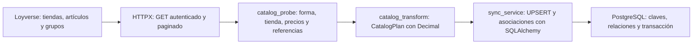
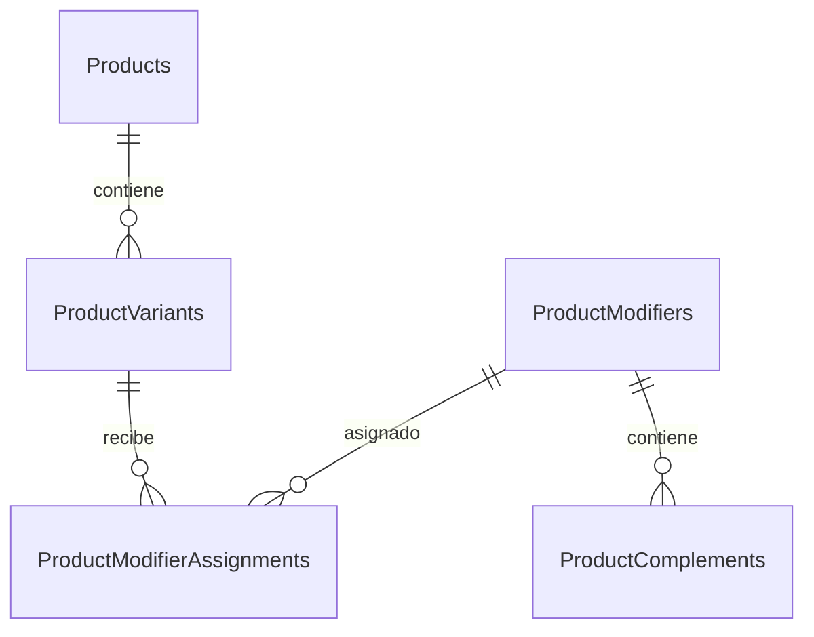

# Guía técnica de estudio — MITBOL v2.1, HU-008

**Corte de verificación: 2 de noviembre de 2026.** Este material se basa en los
archivos del repositorio, los informes de ejecución guardados y una nueva
inspección de PostgreSQL en modo de sólo lectura. No se volvió a sincronizar
Loyverse ni se modificó el código funcional, los endpoints o las migraciones.

## Cómo estudiar este material

1. Lee el objetivo, el flujo y las cinco tablas de esta guía.
2. Recorre los cuatro bloques y los ocho fragmentos explicados línea por línea.
3. Ejecuta las consultas de [comprobaciones.sql](comprobaciones.sql) en pgAdmin.
4. Practica la [presentación de cinco minutos y las preguntas](presentacion_y_defensa.md).
5. Repasa el [resumen de una página](resumen_una_pagina.md).

Evidencia de esta revisión: [verificacion.json](verificacion.json),
[pruebas_actuales.json](pruebas_actuales.json), [salida de pytest](pruebas_actuales.txt)
y [resultados SQL](resultados_sql.json).
El primer archivo identifica el commit revisado, las huellas SHA-256 de los
archivos fuente, las filas consultadas y las respuestas de FastAPI.

## 1. Qué implementamos

HU-008 incorpora el catálogo comercial de Loyverse a las cinco tablas aprobadas
de MITBOL. Loyverse aporta identidades, nombres, variantes, precios, grupos y
opciones; MITBOL conserva su enriquecimiento y sus decisiones locales.

Se implementaron descarga completa, validación, transformación, inserción y
actualización sin duplicados, transacciones, control de concurrencia y tratamiento
de bajas explícitas. Se probaron la primera carga real, su repetición y un cambio
de precio real. Son operaciones controladas del backend; todavía no constituyen
un menú público conectado a PostgreSQL ni una administración de sincronizaciones.

### Resultado confirmado en PostgreSQL

| Tabla | Filas | Ejemplo real |
| --- | ---: | --- |
| `Products` | 3 | Hamburguesa clásica, producto interno 3 |
| `ProductVariants` | 5 | Doble, variante interna 5, precio 129.00 |
| `ProductModifiers` | 2 | Extras bebida y Extras hamburguesa |
| `ProductComplements` | 5 | Queso extra, precio 15.00 |
| `ProductModifierAssignments` | 4 | Variante Doble 5 → grupo Extras hamburguesa 2 |

La lectura actual encontró cero grupos de identificadores duplicados en las
cinco tablas. La historia del cambio 119→129 está en el
[informe del Bloque 4](../../loyverse/hu008_block4_price_update_report.json);
una consulta actual sólo demuestra el estado actual, no el precio anterior.

### Flujo completo y responsabilidades



`SyncService.synchronize()` abre la transacción y obtiene el bloqueo **antes** de
la descarga; el diagrama muestra el recorrido de los datos. HTTPX obtiene JSON,
`catalog_probe` permite inspeccionarlo y reutiliza validaciones, y la transformación
produce los datos comerciales que sí caben en el modelo. SQLAlchemy construye
las instrucciones SQL y PostgreSQL las ejecuta.

Los scripts de las cargas reales reutilizan `_transaction()`, `_plan()` y
`_write()`, la misma secuencia interna del servicio, añadiendo una pausa para
mostrar el plan y comprobaciones específicas del experimento. Sus JSON son
evidencia de ejecución; no son tablas nuevas ni una interfaz administrativa.

## 2. Estructura y archivos principales

```text
mitbol-backend/
├── app/
│   ├── main.py
│   ├── api/sync.py                    # Router antiguo, sin registrar
│   ├── cli/probe_loyverse.py          # Diagnóstico remoto, sólo GET
│   ├── core/config.py                # Settings y SecretStr
│   ├── db/{base,database}.py          # Metadatos, engine y sesiones
│   ├── models/
│   │   ├── product.py
│   │   ├── product_variant.py
│   │   ├── product_modifier.py
│   │   ├── product_complement.py
│   │   ├── product_modifier_assignment.py
│   │   └── {legacy_base,item,category}.py
│   └── services/
│       ├── loyverse_client.py
│       ├── catalog_probe.py
│       ├── catalog_transform.py
│       ├── catalog_errors.py
│       ├── sync_service.py
│       └── legacy_sync_service.py
├── migrations/
│   ├── env.py
│   ├── validation.py
│   └── versions/20261029_0001_hu008_catalog.py
├── tests/                            # HTTP, modelos, transformación y PostgreSQL
└── docs/
    ├── database/                     # Preparación de mitbol_dev
    ├── loyverse/                     # Ejecuciones e informes de los bloques
    └── learning/hu008/                # Esta guía y su evidencia
```

| Archivo | Responsabilidad y conexión con los demás |
| --- | --- |
| [config.py](../../../app/core/config.py) | Lee `DATABASE_URL`, `LOYVERSE_ACCESS_TOKEN` y `LOYVERSE_STORE_ID`; el token usa `SecretStr`. No se publican los valores secretos. |
| [base.py](../../../app/db/base.py) | Declara `Base` y nombres de restricciones. Importarlo no conecta a PostgreSQL. |
| [database.py](../../../app/db/database.py) | Configura `engine`, `SessionLocal` y `get_db()` para dependencias de rutas. El servicio nuevo admite una fábrica explícita de sesiones. |
| [models](../../../app/models/__init__.py) | Registra únicamente las cinco tablas vigentes en `Base`. `LegacyBase` separa `items` y `categories`. |
| [loyverse_client.py](../../../app/services/loyverse_client.py) | HTTPX, autenticación, JSON, paginación y reintentos. No persiste datos. |
| [catalog_probe.py](../../../app/services/catalog_probe.py) | `fetch_catalog()` descarga; `describe_catalog()` inspecciona en memoria; `select_store()` elige la tienda. No importa SQLAlchemy. |
| [catalog_transform.py](../../../app/services/catalog_transform.py) | `transform_catalog()` prepara un `CatalogPlan` validado con entidades, relaciones y bajas. No abre conexiones. |
| [catalog_errors.py](../../../app/services/catalog_errors.py) | Distingue destino, validación, referencias, concurrencia y persistencia. |
| [sync_service.py](../../../app/services/sync_service.py) | Comprueba base/tienda, obtiene el bloqueo, ejecuta los UPSERT, mantiene las FK y procesa bajas en una transacción. |
| [probe_loyverse.py](../../../app/cli/probe_loyverse.py) | Comando de diagnóstico remoto. Puede guardar un informe; no llama al escritor. |
| [migrations/env.py](../../../migrations/env.py) | Usa los metadatos actuales, carga la URL y ofrece modo offline y online. |
| [migrations/validation.py](../../../migrations/validation.py) | Rechaza la migración inicial sobre una base con objetos de aplicación sin revisión instalada. |
| [tests/conftest.py](../../../tests/conftest.py) | Catálogo simulado y PostgreSQL aislado, activado expresamente. |
| [main.py](../../../app/main.py) | Crea FastAPI y conserva las rutas de demostración; no ejecuta `create_all()`. |

## 3. Las cinco tablas y las identidades



| Tabla | Por qué existe | Claves y datos relevantes |
| --- | --- | --- |
| Products | Agrupa la información común de un artículo y su enriquecimiento local. | PK `product_id`; `loyverse_id` único; nombre, descripción y banderas. |
| ProductVariants | Separa presentaciones que tienen identidad y precio propios. | PK `product_variant_id`; UUID externo único; FK `product_id`; `price` NUMERIC. |
| ProductModifiers | Representa el grupo, por ejemplo Extras hamburguesa. | PK `product_modifier_id`; UUID externo único; nombre y orden. No tiene `is_active`. |
| ProductComplements | Representa cada opción con precio adicional, por ejemplo Queso extra. | PK `product_complement_id`; UUID externo único; FK al grupo; precio, orden y estado. |
| ProductModifierAssignments | Resuelve la relación de muchos a muchos entre variantes y grupos. | PK compuesta por las dos FK. No tiene UUID propio ni una PK artificial adicional. |

**Identidad externa:** `loyverse_id` permite reconocer el mismo objeto cuando se
vuelve a descargar. **Identidad interna:** las PK enteras sostienen las relaciones
de MITBOL. Doble conserva el UUID `246aad80-4540-4c1a-8877-2e31bc03d668`, PK 5 y
producto padre 3 aun cuando cambia de precio.

`ForeignKey` define una restricción SQL que impide referencias inexistentes.
`relationship()` permite navegar objetos Python, por ejemplo `variant.product`;
no agrega una columna ni sustituye la FK. Las cuatro relaciones por FK del
esquema son variante→producto, complemento→grupo y las dos de asignaciones.

Los nombres de tablas tienen mayúsculas: en SQL se escribe `"ProductVariants"`.
El tipo `NUMERIC` no tiene precisión ni escala impuestas por este modelo.
`synced_at` admite zona horaria; sólo es nullable en ProductModifiers.

## 4. Los cuatro bloques

### Bloque 1 — Descargar y comprender el catálogo

**Autenticación.** `LoyverseAPIClient` usa la URL definida en el código,
`https://api.loyverse.com/v1.0`, y envía `Authorization: Bearer ...`. El token se
proporciona por configuración; no se implementó aquí un flujo OAuth ni renovación
automática. `SecretStr` oculta su representación habitual, pero no equivale a
cifrar el archivo `.env`.

**HTTPX.** `AsyncClient` realiza GET y se cierra mediante contexto asíncrono.
El timeout configurado por defecto es de 15 segundos para operaciones HTTP y
de hasta 5 segundos para conexión. No es un plazo global para todo el catálogo.
No sigue redirecciones y sólo acepta las rutas incluidas en `READ_ENDPOINTS`.
El catálogo vigente consulta `/stores`, `/items` y `/modifiers`; variantes y
opciones ya vienen anidadas, evitando consultas duplicadas.

**Paginación.** `get_all_paginated()` conserva filtros y envía `limit` y `cursor`.
Acumula páginas hasta que no hay otro cursor. Rechaza cursores inválidos o
repetidos, páginas vacías con continuación y colecciones incompletas; tiene un
tope de 1000 páginas. El tamaño predeterminado es 250, y las lecturas controladas
usaron 2. `/stores` tiene su método separado y no recibe una paginación inventada.

**Tenacity.** `get()` permite por defecto tres intentos ante `TransportError`,
HTTP 408, 429 o 5xx. `_retry_wait()` respeta `Retry-After`; si supera el límite
configurado de 300 segundos, aborta en lugar de reintentar antes. Sin cabecera,
usa espera exponencial acotada. Los errores permanentes, redirecciones y JSON
inválido no se convierten en éxitos ni se reintentan indiscriminadamente.

**Tienda y procedencia del precio.** `select_store()` exige el ID configurado si
existe; sin él sólo puede elegir una única tienda activa. Las operaciones reales
confirmaron **I.C.E**, ID `9e30730f-a5b4-4485-8cc4-bc499cc6e239`.
`_inspect_variant()` toma `variants[].stores[].price` de esa tienda y exige
`pricing_type=FIXED`; no rellena precios desconocidos con cero ni con otro precio.
En complementos usa `modifier_options[].price` y verifica que el grupo pertenezca
a la tienda. El modelo tiene un precio por variante y no conserva precios por
múltiples tiendas simultáneamente.

**Decimal.** El JSON se decodifica con `parse_float=Decimal`, preservando el
decimal antes de cualquier conversión a `float`. Los enteros también pueden
representar importes; `_money()` conserva el valor como texto en el diagnóstico
y `_price()` vuelve a un Decimal validado en la transformación. Se rechazan
booleanos como dinero, importes no finitos, negativos y configuraciones desconocidas.
El cero explícito de Sin cebolla es válido.

**Hallazgo real.** La lectura observada usa `modifier_ids`; el código conserva
compatibilidad explícita con `modifiers_ids`, el otro alias documentado en el
trabajo previo. `_article_modifier_ids()` rechaza ausencia o contradicciones entre
ambos. No presume campos adicionales de la API.

El [informe del Bloque 1](../../loyverse/hu008_block1_report.json) contiene 3
artículos, 5 variantes, 2 grupos, 5 opciones y **2 asociaciones artículo–grupo**.
Esas dos relaciones luego producen **4 asociaciones variante–grupo**.

### Bloque 2 — Transformar y persistir con seguridad

`CatalogSnapshot` guarda la lectura en memoria. `CatalogPlan` contiene tuplas de
`ProductData`, `VariantData`, `ModifierData`, `ComplementData`, asignaciones y
bajas. Son dataclasses; las del plan son `frozen=True`. Esto organiza el contrato
interno sin crear tablas. El snapshot contiene diccionarios: `frozen=True` no
vuelve inmutable el contenido de esos diccionarios. La transformación hace copias
y una prueba comprueba que no altera la descarga.

La transformación valida IDs y nombres contra sus límites del esquema, posiciones
INTEGER, padres, duplicados y fechas con zona horaria. Exige una lectura que
incluya bajas y deriva el nombre de una variante de sus valores de opción;
si no tiene opciones, utiliza el nombre del producto. Un grupo del artículo
se asigna a cada variante activa, sin inventar mínimos o selecciones obligatorias.

`_write()` procesa productos y grupos antes de variantes y complementos, y al
final las asignaciones. Sus mapas convierten UUID externos en PK internas.
`_upsert()` usa `INSERT ... ON CONFLICT DO UPDATE` sobre `loyverse_id`, recupera
la PK con `RETURNING` y rechaza que una variante o complemento existente cambie
de padre. La tabla de asignaciones usa `ON CONFLICT DO NOTHING` sobre su PK doble.

**Protección local.** Los UPSERT de Products actualizan nombre, estado comercial
y fecha; preservan `description`, `is_available`, `is_featured` e `is_new`.
En variantes existentes se conserva `is_available`; las nuevas toman inicialmente
la disponibilidad comercial observada. No se escriben fotografías ni etiquetas;
sus tablas no están instaladas en este esquema de cinco entidades.

**Transacción.** `session.begin()` confirma una ejecución completa o revierte
si sale una excepción. Los métodos por entidad no hacen commits separados.
`_transaction()` comprueba el dialecto PostgreSQL y `current_database()` antes de
escribir. El servicio admite `mitbol_dev` o el patrón estricto de nombres de prueba.

**Concurrencia.** `pg_try_advisory_xact_lock` con una clave común rechaza otra
sincronización del servicio mientras corre la primera. Se mantiene desde antes
de la descarga y se libera al commit/rollback. Coordina a quienes usan esa clave;
no bloquea por sí mismo cualquier edición SQL manual. Mantener la conexión
durante HTTP es un coste de esta estrategia, con tiempos y reintentos limitados.

**Bajas sin pérdida de identidad.** Una ausencia en la respuesta no equivale a
una baja. `deleted_at` explícito desactiva productos/complementos o deja variantes
no disponibles; no borra esas entidades. Un grupo carece de `is_active`, así que
se conservan su fila y sus IDs, desactivando sus opciones y retirando asignaciones.
Las únicas eliminaciones del servicio son asociaciones comerciales obsoletas.
Una baja nunca importada no fabrica filas con campos o precios desconocidos.

La baja explícita es una excepción al mantenimiento de disponibilidad de variantes:
la fuerza a falso. Una reaparición no vuelve a habilitar automáticamente esa
bandera local. Una referencia inválida o una reasignación histórica provoca error
y rollback en lugar de modificar las relaciones acordadas.

### Bloque 3 — Primera carga real

Se verificaron destino, tienda, revisión y tablas vacías; se descargó un catálogo
nuevo y se mostró el plan antes de escribir. La carga creó **3/5/2/5/4** filas.
Dos artículos dados de baja que no existían en MITBOL no afectaron registros.
El catálogo con bajas necesitó cinco GET usando páginas de dos registros:
una página de tiendas, tres de artículos y una de grupos.

Se compararon los registros dentro de la transacción y desde otra conexión de
sólo lectura después del commit. El [informe del Bloque 3](../../loyverse/hu008_block3_report.json)
conserva el plan, los IDs, precios, relaciones y resultados; los conteos
`*_processed` del servicio describen registros procesados, no necesariamente
inserciones nuevas en futuras ejecuciones.

### Bloque 4 — Repetir y cambiar un precio

**Idempotencia:** una nueva lectura del mismo catálogo mantuvo todas las filas
de negocio, UUID, PK, FK, precios y campos locales. Sólo cambió `synced_at` en
las 15 entidades; las cuatro asignaciones permanecieron iguales. Las secuencias
avanzaron al intentar INSERT que terminaron en conflicto: eso no implica nuevos
registros ni reasignación de PK. Véase el
[informe de idempotencia](../../loyverse/hu008_block4_idempotency_report.json).

**Cambio comercial:** el usuario cambió Doble de 119 a 129 MXN en I.C.E. Antes
de escribir se verificó que fuera el único cambio comercial. El UPSERT actualizó
la variante **5**, con UUID `246aad80-4540-4c1a-8877-2e31bc03d668`, manteniendo el
producto padre **3** y su grupo **2**. Los otros cuatro precios de variantes y
los cinco de complementos quedaron iguales. El
[informe de actualización](../../loyverse/hu008_block4_price_update_report.json)
compara todas las columnas de negocio, permitiendo sólo ese importe y las fechas
nuevas. No se escribió 129 manualmente en PostgreSQL: se persistió el plan remoto
validado. La lectura actual vuelve a confirmar 129.00.

## 5. Ocho fragmentos reales, explicados línea por línea

Los fragmentos se extraen del código sin reescribirlo. Las referencias L1, L2,
etc. son posiciones **dentro de cada fragmento**; las líneas vacías sólo separan
ideas. [fragmentos.json](fragmentos.json) registra archivo, líneas y huella para
comprobar cada extracción. Son ocho fragmentos seleccionados; los comandos y
consultas de las secciones siguientes son material de demostración.

### F1. Modelo de variante: identidad, dinero y producto padre

<!-- fragment:F1 -->
Fuente: [app/models/product_variant.py](../../../app/models/product_variant.py#L19), l?neas 19?30.

```python
class ProductVariant(Base):
    __tablename__ = "ProductVariants"

    product_variant_id: Mapped[int] = mapped_column(Integer, primary_key=True)
    loyverse_id: Mapped[str] = mapped_column(String(100), unique=True)
    name: Mapped[str] = mapped_column(String(150))
    price: Mapped[Decimal] = mapped_column(Numeric)
    is_available: Mapped[bool] = mapped_column(Boolean, server_default=true())
    synced_at: Mapped[datetime] = mapped_column(DateTime(timezone=True))
    product_id: Mapped[int] = mapped_column(ForeignKey("Products.product_id"))

    product: Mapped[Product] = relationship(back_populates="variants")
```

| Línea | Qué hace y por qué |
| --- | --- |
| L1 | Hereda de `Base`: registra la clase en los metadatos ORM vigentes. |
| L2 | Conserva exactamente el nombre aprobado de la tabla. |
| L4 | Declara la PK entera interna; PostgreSQL la genera conforme a la migración. |
| L5 | Define el ID externo y su unicidad: el mismo objeto remoto no puede repetirse. |
| L6 | Limita el nombre comercial a 150 caracteres. |
| L7 | Une `Decimal` en Python con `NUMERIC` en SQL, sin escala inventada. |
| L8 | Define la disponibilidad y su default en el servidor para registros nuevos. |
| L9 | Guarda una fecha consciente de zona horaria. |
| L10 | La FK obliga a que exista el producto padre. |
| L12 | Permite `variant.product` y la navegación inversa por `Product.variants`. |

Los tipos `Mapped` no opcionales permiten inferir NOT NULL en estas columnas.
La prueba del esquema compara esa nulabilidad y los tipos con PostgreSQL real.

### F2. Migración Alembic: la asociación se crea con sus restricciones

<!-- fragment:F2 -->
Fuente: [migrations/versions/20261029_0001_hu008_catalog.py](../../../migrations/versions/20261029_0001_hu008_catalog.py#L77), l?neas 77?92.

```python
op.create_table(
    "ProductModifierAssignments",
    sa.Column("product_variant_id", sa.Integer(), nullable=False),
    sa.Column("product_modifier_id", sa.Integer(), nullable=False),
    sa.PrimaryKeyConstraint(
        "product_variant_id", "product_modifier_id", name="pk_ProductModifierAssignments"
    ),
    sa.ForeignKeyConstraint(
        ["product_variant_id"], ["ProductVariants.product_variant_id"],
        name="fk_ProductModifierAssignments_product_variant_id",
    ),
    sa.ForeignKeyConstraint(
        ["product_modifier_id"], ["ProductModifiers.product_modifier_id"],
        name="fk_ProductModifierAssignments_product_modifier_id",
    ),
)
```

| Línea | Qué hace y por qué |
| --- | --- |
| L1 | Solicita a Alembic crear una tabla durante `upgrade()`. |
| L2 | Usa el nombre exacto del modelo relacional. |
| L3 | Crea el ID de variante obligatorio, de tipo entero. |
| L4 | Crea el ID de grupo obligatorio. |
| L5 | Inicia la definición de una PK compuesta. |
| L6 | Las dos columnas juntas identifican la pareja; nombra la restricción. |
| L7 | Cierra esa restricción. |
| L8 | Inicia la FK de variante. |
| L9 | Declara su columna local y el destino `ProductVariants.product_variant_id`. |
| L10 | Da nombre estable a esa FK. |
| L11 | Cierra la primera FK. |
| L12 | Inicia la FK de grupo. |
| L13 | Declara la referencia a `ProductModifiers.product_modifier_id`. |
| L14 | Nombra la segunda FK. |
| L15 | Cierra la segunda FK. |
| L16 | Cierra `create_table()`. La base impide duplicados y referencias inexistentes. |

Esta operación pertenece a `20261029_0001`, cuya `down_revision` es `None`.
Se ejecutó después de crear las tablas padre. Leer este fragmento no ejecuta DDL.

### F3. HTTPX: cliente autenticado y con límites

<!-- fragment:F3 -->
Fuente: [app/services/loyverse_client.py](../../../app/services/loyverse_client.py#L97), l?neas 97?103.

```python
self._http = httpx.AsyncClient(
    base_url=self.BASE_URL,
    headers={"Authorization": f"Bearer {token.strip()}"},
    timeout=httpx.Timeout(timeout_seconds, connect=min(5.0, timeout_seconds)),
    follow_redirects=False,
    transport=transport,
)
```

| Línea | Qué hace y por qué |
| --- | --- |
| L1 | Crea un cliente HTTP asíncrono reutilizable para la descarga. |
| L2 | Fija el origen de la API definido por la clase. |
| L3 | Envía el token Bearer, limpiando espacios exteriores. |
| L4 | Configura tiempos de operación y conexión; evita esperas indefinidas por solicitud. |
| L5 | Impide seguir redirecciones automáticamente con las credenciales. |
| L6 | Permite un transporte inyectado, usado para simular HTTP en pruebas. |
| L7 | Finaliza la construcción; el contexto asíncrono se encargará del cierre. |

### F4. JSON y dinero: conservar el decimal original

<!-- fragment:F4 -->
Fuente: [app/services/loyverse_client.py](../../../app/services/loyverse_client.py#L168), l?neas 168?170.

```python
data = json.loads(
    response.content, parse_float=Decimal, parse_constant=_reject_json_constant,
)
```

| Línea | Qué hace y por qué |
| --- | --- |
| L1 | Decodifica el contenido JSON y lo asigna a `data`. |
| L2 | Usa los bytes recibidos, convierte decimales JSON directamente a Decimal y rechaza constantes no válidas como NaN. |
| L3 | Cierra la llamada. El bloque siguiente traduce JSON inválido a `LoyverseResponseError`. |

El número sigue siendo validado después: decodificar Decimal no convierte en
válido un precio negativo, nulo o variable.

### F5. Transformación: variante comercial y expansión de asociaciones

<!-- fragment:F5 -->
Fuente: [app/services/catalog_transform.py](../../../app/services/catalog_transform.py#L205), l?neas 205?210.

```python
variant_name = _name(" / ".join(values) if values else name)
variants.append(VariantData(
    variant["id"], item["id"], variant_name,
    _price(variant["store_price"]), variant["available_for_sale"],
))
assignments.extend((variant["id"], modifier_id) for modifier_id in item["modifier_ids"])
```

| Línea | Qué hace y por qué |
| --- | --- |
| L1 | Usa valores reales de opciones para nombrar la variante; sin opciones usa el nombre del artículo. |
| L2 | Empieza a construir y añadir un `VariantData`. |
| L3 | Conserva UUID de variante, UUID de producto padre y nombre derivado. |
| L4 | Valida el precio de la tienda y conserva la disponibilidad observada para la inserción inicial. |
| L5 | Cierra la creación y el añadido del objeto. |
| L6 | Genera una pareja variante–grupo por cada grupo declarado en el artículo. |

Doble y Sencilla reciben el grupo Extras hamburguesa; los dos tamaños de
Limonada reciben Extras bebida. No se inventan restricciones de selección.

### F6. UPSERT: identidad externa, columnas permitidas y padre estable

<!-- fragment:F6 -->
Fuente: [app/services/sync_service.py](../../../app/services/sync_service.py#L80), l?neas 80?94.

```python
table = model.__table__
statement = insert(table).values(**values)
options = {
    "index_elements": [table.c.loyverse_id],
    "set_": {field: statement.excluded[field] for field in fields},
}
if parent:
    # Nunca reasignar una identidad histórica a otro producto o grupo.
    options["where"] = table.c[parent] == statement.excluded[parent]
statement = statement.on_conflict_do_update(**options)
primary_key = next(iter(table.primary_key.columns))
identifier = session.execute(statement.returning(primary_key)).scalar_one_or_none()
if identifier is None:
    raise CatalogReferenceError("Un identificador existente cambió de producto o grupo padre.")
return identifier
```

| Línea | Qué hace y por qué |
| --- | --- |
| L1 | Obtiene la tabla SQL a partir de la clase del modelo. |
| L2 | Construye el INSERT con los datos comerciales del plan. |
| L3 | Abre la configuración de resolución de conflictos. |
| L4 | Usa la clave única `loyverse_id` como identidad del conflicto. |
| L5 | Actualiza únicamente `fields` desde los valores entrantes (`excluded`). |
| L6 | Cierra esa configuración. |
| L7 | Activa una protección adicional si la entidad tiene padre. |
| L8 | Explica que una identidad histórica no debe cambiar de padre. |
| L9 | Condiciona el UPDATE a que el padre previo y el entrante coincidan. |
| L10 | Añade `ON CONFLICT DO UPDATE` a la sentencia. |
| L11 | Obtiene la columna PK de una entidad comercial; esta función no se usa para la asociación compuesta. |
| L12 | Ejecuta y recupera la PK del INSERT o UPDATE mediante RETURNING. |
| L13 | Detecta que no hubo resultado, como sucede al impedir una reasignación de padre. |
| L14 | Genera el error de referencia y deja que la transacción se revierta. |
| L15 | Devuelve el ID interno para construir las relaciones siguientes. |

En Products, `fields` sólo contiene nombre, `is_active` y `synced_at`; en
variantes contiene nombre, precio y fecha. Por eso los campos locales no se
sobrescriben, aunque existan en los valores de una inserción nueva.

### F7. Transacción, destino y bloqueo entre sincronizaciones

<!-- fragment:F7 -->
Fuente: [app/services/sync_service.py](../../../app/services/sync_service.py#L44), l?neas 44?52.

```python
with self.session_factory() as session, session.begin():
    if session.get_bind().dialect.name != "postgresql":
        raise CatalogTargetError("La sincronización requiere PostgreSQL.")
    actual_database = session.scalar(select(func.current_database()))
    if actual_database != self.expected_database:
        raise CatalogTargetError("La conexión real no coincide con la base autorizada.")
    if not session.scalar(select(func.pg_try_advisory_xact_lock(CATALOG_SYNC_LOCK_KEY))):
        raise CatalogSyncBusyError("Ya hay una sincronización comercial en ejecución.")
    yield session
```

| Línea | Qué hace y por qué |
| --- | --- |
| L1 | Abre una sesión y una transacción con commit al salir correctamente o rollback ante excepción. |
| L2 | Exige el dialecto PostgreSQL. |
| L3 | Rechaza otro motor antes de persistir. |
| L4 | Pregunta al servidor la base efectiva, además de leer configuración. |
| L5 | La compara con la base esperada por el servicio. |
| L6 | Aborta si el destino no coincide. |
| L7 | Intenta adquirir el bloqueo transaccional común al catálogo. |
| L8 | Rechaza la segunda sincronización si otra transacción ya posee la clave. |
| L9 | Entrega la sesión al cuerpo del contexto, que descarga, transforma y escribe. |

El `yield` no confirma: el commit ocurre al salir de `session.begin()`.
La captura posterior de `SQLAlchemyError` produce un error de persistencia
seguro después del rollback. Los errores de validación también salen del contexto
y provocan rollback aunque no pertenezcan a esa clase.

### F8. Fixture de PostgreSQL aislado y savepoints

<!-- fragment:F8 -->
Fuente: [tests/conftest.py](../../../tests/conftest.py#L123), l?neas 123?129.

```python
engine = sync_test_database
with engine.connect() as connection:
    transaction = connection.begin()
    sessions = sessionmaker(
        bind=connection, join_transaction_mode="create_savepoint", expire_on_commit=False,
    )
    service = SyncService(sessions, expected_database=engine.url.database, store_id="test-store")
```

| Línea | Qué hace y por qué |
| --- | --- |
| L1 | Obtiene el motor de la base de pruebas preparada por otra fixture. |
| L2 | Abre una conexión exclusiva para el caso de prueba. |
| L3 | Inicia una transacción exterior que la fixture revertirá al final. |
| L4 | Crea la fábrica de sesiones que recibe el servicio. |
| L5 | Liga las sesiones a esa conexión; `create_savepoint` mantiene sus commits dentro de la transacción exterior y conserva objetos sin expirarlos. |
| L6 | Cierra la fábrica. |
| L7 | Construye el servicio con base y tienda de pruebas explícitas. |

El `finally` de la misma fixture llama a `transaction.rollback()`. Esto permite
probar los commits del servicio sin conservar filas del caso. Las secuencias no
se revierten del mismo modo; los IDs de pruebas pueden tener saltos.

## 6. Base de datos, migraciones y pruebas

### Conceptos aplicados al proyecto

**SQLAlchemy** construye y ejecuta SQL. Su **ORM** mapea clases y relaciones a
tablas y filas. Este servicio combina modelos ORM con INSERT/UPDATE/DELETE de
SQLAlchemy Core para usar el UPSERT específico de PostgreSQL. No es obligatorio
recorrer objetos con `session.add()` para aprovechar sus modelos y sesiones.

**Alembic** versiona cambios de estructura. La migración inicial describe las
cinco tablas y sus restricciones. **`alembic_version`** es una tabla técnica que
guarda la revisión instalada; no cuenta productos ni registra ejecuciones del
catálogo. Una sincronización comercial modifica datos, no la revisión.

### Por qué creamos mitbol_dev

El [registro de preparación](../../database/hu008_preparation.md) describe que
`mitbol_db` pertenecía al prototipo con `items` y `categories`. Se decidió
conservarlo y crear otra base vacía desde `template0`, según
[create_mitbol_dev.sql](../../database/create_mitbol_dev.sql). Después se cambió
la conexión y se aplicó `20261029_0001` con autorización. Crear la base fue una
operación separada de aplicar Alembic.

Hoy se comprobó la revisión mediante SELECT de sólo lectura, sin volver a crear
la base ni aplicar migraciones. FastAPI ya no ejecuta `Base.metadata.create_all()`
al arrancar. Ese método sí aparece en pruebas SQLite en memoria y en el prototipo
aislado; su presencia en tests no significa que el servidor modifique el esquema.

### Cómo se evitan duplicados y relaciones incorrectas

Las cuatro entidades tienen UUID externos únicos; la quinta tabla tiene PK
compuesta. Las FK impiden referencias inexistentes, el transformador comprueba
que cada variante declare su artículo correcto y el UPSERT impide mover una
identidad existente de padre. Además se compararon las asociaciones exactas:
una FK válida por sí sola no garantiza que se haya elegido el padre comercial
correcto. Tampoco bastan conteos iguales para probar estabilidad de identidad.

### Qué pruebas hay y qué hace cada herramienta

| Archivos | Herramienta y evidencia |
| --- | --- |
| `test_loyverse_client.py` | RESPX intercepta HTTPX con token ficticio. Prueba cursores, cabeceras, Decimal, errores HTTP, conexión y Retry-After. |
| `test_catalog_probe.py` | `httpx.MockTransport` entrega respuestas preparadas; comprueba tienda, procedencia de precio y referencias sin SQLAlchemy. |
| `test_catalog_transform.py` | pytest parametriza configuraciones inválidas, dinero y referencias; verifica el plan y que no se modifique el snapshot. |
| `test_catalog_models.py` | SQLite efímera con FK activadas: relaciones, unicidad y nulabilidad. No sustituye las pruebas del dialecto PostgreSQL. |
| `test_migrations.py` | Compara modelos/migración, genera SQL offline, valida el rechazo del prototipo y usa `ASGITransport` para FastAPI en memoria. |
| `test_postgresql_schema.py` | Seis casos que leen el esquema instalado con `default_transaction_read_only=on`. |
| `test_catalog_sync_postgresql.py` | 32 casos parametrizados de inserción, repetición, campos locales, precios, bajas, rollback, destino y bloqueo en PostgreSQL aislado. |
| `test_sync.py` | Una regresión del prototipo en SQLite. No debe presentarse como prueba del escritor nuevo de HU-008. |

La fixture de persistencia requiere `MITBOL_SYNC_POSTGRES_TESTS=1`. Crea una base
aleatoria `mitbol_test_hu008_<12 hex>`, aplica allí la revisión existente y usa
savepoints por prueba. No elimina la base al terminar: conserva esquema y revisión
con cero filas comerciales. La comprobación de desarrollo de esa fixture compara
conteos antes/después; las operaciones controladas reales compararon filas completas.

El caso `test_real_postgresql_error_rolls_back_all_previous_upserts` provoca un
`SELECT 1 / 0` después de varios UPSERT, y verifica la reversión de inserciones y
de cambios en registros existentes. La prueba de concurrencia usa dos conexiones
reales; las pruebas HTTP+persistencia usan MockTransport, no la cuenta real.

### Resultado actual y resultado histórico: cómo explicarlos con precisión

| Verificación | Resultado | Alcance |
| --- | --- | --- |
| Suite completa registrada al cerrar el cambio de precio | **125 aprobadas en 19.16 s** | Informe histórico; incluía escrituras en otra base PostgreSQL. |
| Comprobación posterior de ese bloque | **7 aprobadas en 1.99 s** | Un caso de persistencia aislado y seis casos de esquema. No son 7 pruebas únicas adicionales al total. |
| Nueva ejecución para esta guía | **93 aprobadas, 32 omitidas en 11.80 s** | Se deshabilitaron las escrituras PostgreSQL para cumplir la restricción actual. Cero fallos. |

La suite sigue incluyendo **125 casos**: 93+32. No se afirma que los 125 se hayan
vuelto a ejecutar hoy. Las 32 omisiones se deben a la fixture desactivada; las
seis pruebas de lectura del esquema sí se ejecutaron. SQLite en memoria, RESPX
y ASGITransport no alteran PostgreSQL. No se creó una base de pruebas en esta
revisión ni se actualizó el informe anterior de su fixture.

### Comandos esenciales desde la raíz del repositorio

Ejecutar las comprobaciones de esta revisión sin escrituras PostgreSQL:

```powershell
$env:MITBOL_POSTGRES_TESTS = '1'
$env:MITBOL_SYNC_POSTGRES_TESTS = '0'
.\.venv\Scripts\python.exe -m pytest -q -rs -p no:cacheprovider
```

Consultar la historia de migraciones o generar SQL para leerlo, sin aplicarlo:

```powershell
.\.venv\Scripts\python.exe -m alembic heads
.\.venv\Scripts\python.exe -m alembic history
.\.venv\Scripts\python.exe -m alembic upgrade head --sql
```

El comando histórico de suite completa usa `MITBOL_SYNC_POSTGRES_TESTS='1'` y el
mismo pytest. Crea otra base y escribe datos simulados; no se ejecutó con ese
valor durante esta tarea documental. La migración online inicial ya se aplicó
en los bloques anteriores; no es un paso para repetir en esta demostración.

El diagnóstico remoto existente, si se necesita una lectura nueva de Loyverse:

```powershell
.\.venv\Scripts\python.exe -m app.cli.probe_loyverse --page-size 2
```

Sólo hace GET; requiere credenciales y acceso de red. No se ejecutó para elaborar
esta guía: el estado remoto de los bloques se acredita con sus informes guardados.
Los scripts `*_run.py` son evidencia y procedimientos acotados de cargas ya
confirmadas; no se deben volver a ejecutar como demostración de sólo lectura.

### Consultas esenciales en pgAdmin

Abre Query Tool conectado a `mitbol_dev` y ejecuta
[comprobaciones.sql](comprobaciones.sql). Incluye base/revisión, conteos, productos,
variantes y precios, complementos, asociaciones y duplicados. Usa una transacción
de sólo lectura. El ROLLBACK final cierra esa consulta, no revierte commits ya
confirmados por otras conexiones.

Para localizar Doble directamente:

```sql
SELECT v.product_variant_id, v.loyverse_id, v.name, v.price,
       p.product_id, p.name AS producto
FROM public."ProductVariants" v
JOIN public."Products" p ON p.product_id = v.product_id
WHERE v.loyverse_id = '246aad80-4540-4c1a-8877-2e31bc03d668';
```

Debe aparecer exactamente una fila con variante 5, producto 3 y precio 129.00.
La moneda MXN procede del contexto indicado por el usuario, no de una columna
de moneda añadida al esquema.

## 7. Decisiones, límites y pendientes

| Decisión comprobada | Motivo y consecuencia |
| --- | --- |
| Separar `mitbol_dev` de `mitbol_db` | Permite usar el esquema real sin borrar el prototipo. |
| Alembic controla el esquema | Arrancar FastAPI no crea tablas; los cambios estructurales son revisables. |
| UUID externo único + PK interna estable | Permite repetir lecturas y actualizar nombres/precios manteniendo relaciones. |
| Decimal/NUMERIC y rechazo de importes desconocidos | Evita introducir errores monetarios o representar un precio ausente como gratuito. |
| Elegir una tienda explícita | El esquema sólo tiene un precio por variante; no se mezclan configuraciones de tiendas. |
| Grupos del artículo expandidos a variantes | Adapta la relación remota a la relación aprobada sin agregar restricciones comerciales. |
| Lista positiva de columnas del UPSERT | Protege el enriquecimiento local. |
| Una transacción y un bloqueo común | Evita estados parciales y carreras entre ejecuciones del servicio. |
| Bajas explícitas y filas conservadas | Protege identidades históricas; ausencia por sí sola no demuestra eliminación. |
| Evidencia antes/después y prueba de sólo un precio | Distingue una actualización correcta de una recreación silenciosa de registros. |

El bloqueo de PostgreSQL no congela Loyverse: sus GET son sucesivos y no hay en
este código un protocolo de snapshot remoto atómico. Las referencias se validan
antes de escribir. Tampoco se ha convertido el acceso SQL síncrono en un ORM
asíncrono; el servicio actual usa HTTP async y sesiones SQLAlchemy síncronas.
Son límites observables del código, no capacidades adicionales de la API.

### Estado del alcance

| Capacidad | Estado verificable |
| --- | --- |
| Descarga, transformación, UPSERT, transacción, bloqueo y bajas | Implementados en el servicio y cubiertos por pruebas. |
| Primera carga real, repetición y precio 119→129 | Ejecutados y verificados con informes. |
| Catálogo de HU-008 expuesto por `GET /api/menu` | **Pendiente**: la ruta sigue devolviendo dos objetos estáticos. |
| Tabla Categories en el modelo real | **Fuera del esquema aprobado**; no es un pendiente para agregar automáticamente. Hay restos del prototipo aislados. |
| Sincronización periódica | **No implementada**. No hay un scheduler activado. |
| Administración, RBAC y registro de ejecuciones de sincronización | **No implementados para el servicio nuevo**. El router antiguo no está registrado y contiene una nota futura de RBAC. |
| Fotografías/etiquetas y otras historias | Sus tablas no están instaladas aquí; no se implementaron HU-009, HU-010 ni pedidos. |

### Comprobación concreta de GET /api/menu

En [app/main.py](../../../app/main.py#L25), `get_menu_test()` devuelve una lista
literal: **Mitbol Clásica 120.00** y **Mitbol Vegana 135.00**. No recibe `get_db()`,
no consulta modelos y no llama al servicio. La comprobación ASGI obtuvo HTTP 200
con esos dos objetos. Por tanto no sirve para demostrar el precio 129 de Doble;
esa demostración se hace en PostgreSQL y con los informes de sincronización.

`app/api/sync.py` aún define la ruta del prototipo y usa `LegacySyncService`,
pero `main.py` no ejecuta `include_router`. La comprobación de
`POST /api/v1/sync/loyverse` devolvió 404. La existencia del archivo no equivale
a tener un endpoint vigente o administración lista.

## 8. Qué llevar a la defensa

Abre este material y señala F1, F2, F6 y F7 para explicar persistencia e identidad.
Muestra el informe de idempotencia y el de actualización para demostrar el cambio
histórico. Ejecuta el SQL de lectura y muestra Doble 5 a 129. Termina identificando
el menú estático como pendiente: sincronizar el catálogo y publicarlo por HTTP
son responsabilidades diferentes en el estado actual del repositorio.
