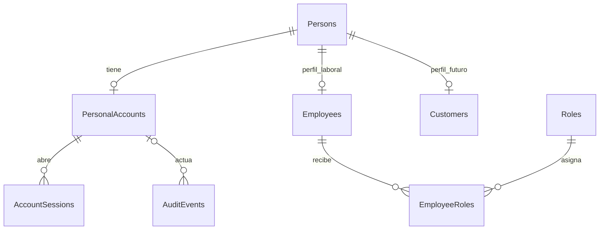

# Diseño revisado: cuentas, autenticación y autorización de MITBOL

Fecha de revisión del diseño: 5 de noviembre de 2026, America/Mexico_City. **Estado actualizado al 6 de noviembre: fases 1–3 implementadas localmente y fase 4 validada en PostgreSQL temporal; infraestructura administrativa real y publicación pendientes.**

El usuario aprobó las siete tablas, identidad única, Argon2id, roles por código, sesiones opacas, auth_version y tiempos configurables. La persistencia está documentada en [fase 1](admin_auth_phase1.md); login/logout, cookies, CSRF, dependencias y limitación local están en [fase 2](admin_auth_phase2.md). Las rutas reales HU-005/HU-007 ahora integran este mecanismo únicamente en local; sus contratos, auditoría y evidencia están en [fase 3](admin_auth_phase3.md). Cloud sigue cerrado.

La [fase 4](admin_auth_phase4.md) añade la matriz SQL, scripts locales y pruebas con logins escritor/lector independientes; retira FOR UPDATE de empleado/roles bajo el protocolo de cuenta/auth_version. No crea todavía el escritor real ni cambia Neon/Render.

La [fase 5](admin_auth_phase5.md) prepara limitación PostgreSQL persistente, aprovisionamiento y despliegue; el dominio queda pendiente por decisión del usuario y cloud sigue bloqueado. El head posterior es 0005, con dos tablas técnicas adicionales que no rediseñan las siete de identidad.

El resto conserva el diseño y registro histórico que originó esas fases. Los estados y nombres tentativos siguientes deben leerse con las guías de implementación posteriores: la variable implementada es `AUTH_ENABLED`, no `ADMIN_AUTH_ENABLED`; CSRF se deriva de la sesión/contexto y sólo su hash se persiste; los flujos HTTP y la integración de permisos ya están implementados localmente.

Esta revisión sustituye la propuesta de cuentas separadas `admin_auth.users`. El diagrama original aportado por el usuario contiene un núcleo de identidad que no estaba disponible en la primera auditoría. La recomendación es reutilizarlo, añadir soporte técnico compartido de sesiones/auditoría y desarrollar primero en local.

Rama conservada: `design/admin-auth-security`, HEAD `df92357780853d7cc89ee3af8d913f23705f6b40`. Esta rama se creó desde `develop` con árbol limpio en la fase anterior; no se cambió de rama, no se hizo fetch, commit ni push. La implementación permanece sin commit.

## 1. Qué está establecido y qué sigue pendiente

| Estado | Alcance |
| --- | --- |
| Requisitos establecidos por el usuario | Argon2id, sesiones revocables, cookies, CSRF, control de intentos, invalidación de sesiones, permisos FastAPI y auditoría administrativa. |
| Requisitos establecidos por el usuario | Dos roles administrativos: Admin y Staff, con los permisos descritos en la sección 6; menú público sin autenticación. |
| Entorno establecido por el usuario | React `http://localhost:5173` consulta el menú en `https://mitbol-backend.onrender.com`. La autenticación se desarrollará aparte con FastAPI `http://localhost:8000` y PostgreSQL local/temporal aislado de Neon y de `mitbol_dev`. |
| Diseño original verificado visualmente | `Persons`, `PersonalAccounts`, `Employees`, `Roles`, `EmployeeRoles` y `Customers`, con los campos descritos en la sección 2. Fase 1 implementó las cinco primeras; Customers sigue pospuesto. |
| Aprobado para fase 1 | Reutilizar las cinco primeras tablas, sin `admin_auth.users`; añadir `AccountSessions` y `AuditEvents`. Posponer `Customers` y el resto del modelo comercial. |
| Aprobado para fase 1 | Unicidad, normalización de email, código estable de rol, auth_version y tiempos configurables. El aprovisionamiento operativo queda para una fase posterior. |
| Recomendación pendiente de aprobación | Limitador en memoria únicamente para el MVP local de un proceso; almacenamiento compartido persistente obligatorio antes de exposición o múltiples procesos. |
| Fuera de fase 1 | Endpoints y servicios de login, cookies/CSRF HTTP, modificar Neon/Render/mitbol_dev y crear el escritor. Migración revisable y pruebas en PostgreSQL temporal sí están autorizadas. |

La autorización actual abarca persistencia y núcleo de seguridad. No autoriza avanzar automáticamente a login, integración React o exposición administrativa.

## 2. Comparación entre diagrama, repositorio y primera propuesta

### 2.1. Lo comprobado en el diagrama

Fuente: imagen original `Diagrama relacional de PostgreSQL.png`, proporcionada en la conversación e inspeccionada a resolución original. Las tablas siguientes describen sólo lo legible; algunos textos DEFAULT quedan recortados. No se deducen valores predeterminados ni índices que la imagen no permite verificar.

| Tabla del diagrama | Campos visibles |
| --- | --- |
| `Persons` | `person_id int` PK; `name varchar(100) NOT NULL`; `phone varchar(20) NOT NULL`; `created_at timestamptz NOT NULL`; `updated_at timestamptz NULL`. |
| `PersonalAccounts` | `account_id int` PK; `person_id int NOT NULL` FK; `email varchar(254) NOT NULL`; `password_hash text NOT NULL`; `is_active boolean NOT NULL`; `email_verified_at timestamptz NULL`; `last_login_at timestamptz NULL`; `created_at timestamptz NOT NULL`; `updated_at timestamptz NULL`. |
| `Employees` | `person_id int` PK y FK; `employee_code varchar(30) NOT NULL`; `hired_at date NOT NULL`; `is_active boolean NOT NULL`; `created_at timestamptz NOT NULL`. |
| `Roles` | `role_id int` PK; `name varchar(50) NOT NULL`; `description text NULL`. |
| `EmployeeRoles` | PK compuesta por `person_id int` FK y `role_id int` FK, ambos NOT NULL. |
| `Customers` | `person_id int` PK y FK; `membership_level_id int NOT NULL` FK; `joined_at timestamptz NOT NULL`; `is_active boolean NOT NULL`. |

Relaciones verificables: `PersonalAccounts.person_id → Persons.person_id`; `Employees.person_id → Persons.person_id`; `EmployeeRoles.person_id → Employees.person_id`; `EmployeeRoles.role_id → Roles.role_id`; `Customers.person_id → Persons.person_id` y relación de `Customers` con `MembershipLevels`.

Las PK compartidas de Employees/Customers permiten un registro de cada perfil por persona. El conector de cuentas/personas sugiere cuenta opcional por persona; **no se aprecia una marca UNIQUE en `PersonalAccounts.person_id`**, por lo que la unicidad deberá acordarse y materializarse en el esquema. Tampoco se aprecia UNIQUE en email, employee_code o nombre de rol. No se asume que ya existan esas restricciones.

`Employees` no tiene un `employee_id` separado; su identificador es `person_id`. `Persons` no muestra un campo de credenciales, rol o estado activo. `Roles` no muestra un código estable ni un estado activo. `EmployeeRoles` no muestra fechas ni permisos individuales. Esos campos no deben presentarse como parte del diagrama original.

### 2.2. Estado físico y código actual

Según el usuario, Neon sólo contiene las ocho tablas actuales del catálogo. [El registro ORM](../../app/models/__init__.py) coincide con ese alcance: `Products`, `ProductVariants`, `ProductModifiers`, `ProductComplements`, `ProductModifierAssignments`, `ProductImages`, `Tags` y `ProductTags`. Fase 1 añadió las siete tablas de identidad en AuthBase.metadata y una migración pendiente de aplicación real; Alembic considera ambos registros. Base.metadata conserva sus ocho tablas de catálogo y no se modificó el esquema remoto.

La protección actual de [HU-005/HU-007](../../app/api/admin_catalog.py) usa `X-Admin-Key` y [un guard local](../../app/core/security.py). Requiere loopback, rechaza proxies y orígenes distintos del propio backend. No autentica empleados ni permite integrar React. [Settings](../../app/core/config.py) rechaza `ADMIN_ENABLED=true` en cloud; [la aplicación](../../app/main.py) no registra esas rutas cuando está apagado. El router antiguo de sincronización sigue sin registrarse y no se reactivará.

[La conexión pública cloud](../../app/db/database.py) usa una sola fábrica de sesiones, con comprobación de privilegios y transacciones read only. [connection.py](../../app/db/connection.py) verifica destino y TLS. No se modificaron estas barreras ni se comprobó remotamente el estado del servicio. Las guías previas de despliegue son evidencia histórica; el estado actual de Render procede del usuario.

### 2.3. Cambios respecto de la primera propuesta

| Aspecto | Primera propuesta | Propuesta revisada |
| --- | --- | --- |
| Identidad y credenciales | `admin_auth.users` independiente. | `Persons` y `PersonalAccounts` compartidas por todo MITBOL. |
| Vinculación laboral | Implícita en usuario administrativo. | `Employees`, identificado por `person_id`. |
| Roles | Campo admin/staff en users. | Filas en `Roles` y asociación mediante `EmployeeRoles`; permisos fijos en código. |
| Sesión y auditoría | Referenciadas a usuario administrativo. | Referenciadas a `PersonalAccounts.account_id`; podrán servir a otros perfiles después. |
| Limitación de intentos | Tabla persistente obligatoria desde el inicio. | Control obligatorio; persistencia posponible sólo en el desarrollo local acotado. |
| Navegador | Dominios de producción pendientes como decisión inicial. | Primero dos puertos de localhost; dominio/proveedor público se decide antes del despliegue autenticado. |
| CORS | Separación por ruta/subaplicación como propuesta inicial. | Una política CORS local explícita es suficiente; la separación de permisos depende de rutas/dependencias, no de crear subaplicaciones. |

La recomendación inicial de una tabla separada era incompleta respecto del diseño global ahora disponible. Se retira para evitar duplicar cuentas y tener que vincularlas o migrar credenciales más adelante.

## 3. Alternativas y arquitectura recomendada

| Alternativa | Ventajas | Desventajas |
| --- | --- | --- |
| Núcleo original de cinco tablas más soporte técnico | Una identidad y una credencial; relaciones laborales explícitas; conserva evolución a clientes y roles múltiples. | Más tablas iniciales que un users aislado; requiere completar restricciones y procedimiento de alta. |
| Esquema administrativo independiente con users propio | Arranque inicial corto y ciclo administrativo aislado. | Duplicación futura de correos/hashes/personas, linking delicado, recuperación duplicada y posible migración de permisos. Separar un esquema no proporciona por sí solo aislamiento del proceso. |
| Implementar todo el diagrama ahora | Modelo comercial completo desde el principio. | Añade membresías, pedidos, promociones y otras dependencias ajenas al login; aumenta el alcance y las pruebas sin necesidad. |

**Recomendación concreta:** implementar por etapas el núcleo `Persons → PersonalAccounts` y `Persons → Employees → EmployeeRoles → Roles`. Añadir sesiones opacas y auditoría referidas a la cuenta. Usar Argon2id, cookie HttpOnly y permisos FastAPI. No crear `admin_auth.users`, una tabla genérica Users adicional ni credenciales por perfil.

No se propone cambiar a OIDC/JWT ni elegir un proveedor externo en esta revisión. Las sesiones opacas satisfacen la revocación del panel. Si aparece un requisito de SSO/MFA, su revisión deberá conservar `PersonalAccounts` como cuenta canónica y acordar una vinculación de identidades antes de implementar otro mecanismo.

Para reducir cambios de convención, se propone mantener los nombres PascalCase del modelo original y ubicar inicialmente las siete tablas en el esquema de aplicación actual `public`. La imagen no especifica ese esquema: es una elección propuesta. Los grants serán explícitos por objeto; el lector público no tendrá SELECT sobre identidad o seguridad. No hace falta un esquema administrativo separado para evitar duplicar identidades; su distribución física puede revisarse con los permisos del futuro escritor sin cambiar estas relaciones.

No crear `Customers`, `MembershipLevels`, `RestaurantRules`, pedidos, visitas o promociones para poder iniciar sesión. Tampoco hacen falta tablas nuevas de Permissions/RolePermissions mientras los permisos sigan siendo fijos.

## 4. Tablas del MVP y ajustes mínimos propuestos

### 4.1. Cinco tablas reutilizadas del diseño

Todas serían nuevas físicamente cuando se autorice la implementación; «reutilizar» significa respetar el diseño original, no que ya existan en Neon.

| Tabla | Función en el MVP | Ajustes propuestos; no observados como existentes |
| --- | --- | --- |
| `Persons` | Identidad personal y nombre visible. | Conservar PK/campos. Definir política para teléfono obligatorio; no inventar teléfonos para satisfacer NOT NULL. |
| `PersonalAccounts` | Login por email, hash Argon2id, estado de acceso. | UNIQUE en `person_id`; email canónico único con normalización coherente en aplicación/DB; `auth_version int NOT NULL` con valor inicial acordado. No añadir role ni duplicar nombre/teléfono aquí. |
| `Employees` | Habilitación del perfil laboral para administración. | Conservar PK/FK `person_id` y estado independiente de la cuenta. Recomendar UNIQUE en `employee_code`; no sustituir `hired_at` por una fecha ficticia. |
| `Roles` | Identificar Admin y Staff. | Añadir `code varchar(30) NOT NULL UNIQUE` estable, con valores `admin` y `staff`. `name` se mantiene como nombre visible; los IDs numéricos no se codifican en la lógica. |
| `EmployeeRoles` | Asignar roles al empleado. | Conservar PK compuesta y FKs; acceso sólo por alta/gestión autorizada. No crear una segunda asignación en PersonalAccounts. |

Propuesta de email canónico: recortar espacios exteriores y tratar mayúsculas/minúsculas como equivalentes por política de MITBOL. No eliminar puntos ni sufijos + como si todos los proveedores fueran iguales. La unicidad debe imponerse sobre esa misma representación en DB, no sólo comprobarse con un SELECT antes de INSERT. El detalle Unicode/validación se fijará al implementar. Cambiar el email no cambia `person_id` ni `account_id`.

Para respetar el modelo sin ampliar innecesariamente el alcance, la propuesta inicial conserva teléfono, código y fecha de contratación obligatorios y exige datos legítimos al dar de alta al propietario/personal. Si el propietario no debe modelarse como empleado o no se desea pedir teléfono, habrá que aprobar un ajuste del modelo antes de programar; no se crearán registros ficticios para salvar esas decisiones.

No se exige email SMTP/verificación automatizada para la prueba local. `email_verified_at` permanece NULL si no hubo verificación real; no se marca como verificado por completar el alta. Antes de registro/recuperación pública de clientes se definirá su política. `last_login_at` se actualizará sólo tras login correcto; no determina validez de sesión.

Conservar FKs y restricciones a nivel DB, con estrategia de generación de IDs int acordada en la migración futura. No borrar cuentas/roles en cascada para «revocar»: desactivar, revocar y conservar referencias de auditoría. Proteger el último administrador con acceso efectivo en la futura gestión de cuentas.

### 4.2. Dos tablas técnicas nuevas recomendadas desde el MVP

Estructura conceptual de la propuesta revisada. La implementación exacta de fase 1 y sus ajustes se documentan por separado; la migración sólo se ha probado en PostgreSQL temporal:

| Tabla | Relaciones y datos propuestos | Persistencia en el MVP |
| --- | --- | --- |
| `AccountSessions` | `session_id` interno; `account_id` FK a PersonalAccounts; `token_hash` único; token CSRF independiente; copia de `auth_version`; creación, última actividad, expiración absoluta, revocación y motivo; fechas UTC e índices de búsqueda/limpieza. | Sí. Permite expiración/revocación y comportamiento correcto al reiniciar el backend. No referencia sólo a Employees ni guarda contraseña, rol autoritativo o token de sesión en claro. |
| `AuditEvents` | Actor `account_id` FK nullable para intentos no identificados; acción, recurso/tipo/ID, resultado, fecha UTC, request ID y metadatos permitidos mínimos. | Sí en esta propuesta, para cumplir auditoría persistente y registrar mutación+evento en la misma transacción. Logs locales solos no dan esa garantía. |

`token_hash` será SHA-256 de un secreto de sesión aleatorio de al menos 256 bits, no de una contraseña. La contraseña sigue usando Argon2id. El token CSRF es otro valor y no autentica por sí solo. Fase 1 reserva únicamente su hash nullable; en fase 2 se definirá su emisión/recuperación/rotación sin persistirlo en claro.

La auditoría cubrirá login/logout y cambios administrativos. Nunca almacenará passwords, cookies, tokens, DSN ni cuerpos completos de solicitudes. El registro de login fallido no exige que exista una cuenta. Retención y limpieza se definen antes de una exposición real; el runtime no debe poder editar/eliminar su historial.

No es universalmente obligatorio que la auditoría sea una tabla: un servicio de eventos durable podría cumplir el requisito. Dado que PostgreSQL ya existe y se desea auditoría transaccional sin servicios nuevos, la tabla es la opción más simple aquí. Sesiones y auditoría tienen funciones distintas y no deben mezclarse.

**Total del MVP propuesto: cinco tablas del diseño y dos de soporte, siete tablas nuevas físicamente además del catálogo actual.**

### 4.3. Control de intentos sin exigir otra tabla inicialmente

El control de intentos es obligatorio desde el primer login. Para un backend accesible sólo en loopback, un único proceso/worker y datos de prueba aislados, se propone un almacén en memoria con expiración, tamaño acotado e incrementos seguros ante concurrencia. Limitar tanto cuenta/email canónico como IP, incluidas cuentas inexistentes, y limitar concurrencia del hashing.

Valor inicial para revisar: cinco fallos por cuenta en quince minutos y un umbral adicional por IP, respuesta 429/Retry-After y espera temporal; sin bloqueo permanente. Los umbrales deberán probarse para no bloquear a todo el equipo por compartir IP.

Ese almacén pierde sus contadores al reiniciar o recargar Uvicorn; no coordina procesos. Es una limitación aceptable únicamente para desarrollo local cerrado y debe quedar visible en configuración y pruebas. No se presenta como protección lista para despliegue ni se reutilizará en cloud.

Antes de acceso externo, varios workers o necesidad de conservar límites tras reinicios, utilizar un almacenamiento compartido persistente; para MITBOL se recomienda entonces `LoginThrottleBuckets` en PostgreSQL con clave derivada, ventana, contador, bloqueo temporal, expiración y operaciones atómicas. Redis no es necesario. Si se quiere verificar persistencia del límite desde el primer MVP, esta tabla puede adelantarse, llevando el total a ocho.

El cambio afectaría sólo al adaptador del limitador; no rehace personas, credenciales, sesiones ni endpoints. Los límites no se calcularán a partir de toda la tabla de auditoría en cada login.

## 5. Modelo de identidad y evolución sin duplicaciones

`person_id` representa a la persona; `account_id` representa sus credenciales/acceso; `Employees` y el futuro `Customers` representan perfiles del negocio. El email es un dato de acceso modificable, no la clave de identidad.

Diagrama conceptual de la propuesta, no esquema ya existente:

La cardinalidad de una cuenta por persona del gráfico anterior corresponde al UNIQUE propuesto. `Customers` aparece sólo para explicar la evolución y no se implementa ahora.

Una misma persona podrá ser empleado y comensal, conservando una sola fila Persons y PersonalAccounts. No se creará otra contraseña ni otro login para su perfil cliente. Un cliente usará el mismo verificador de credenciales y almacenamiento de sesiones; FastAPI aplicará dependencias distintas por operación.

Ser cliente no genera una fila Employees ni EmployeeRoles. El registro público futuro jamás aceptará `role_id`, `employee_code`, pertenencia laboral ni un `person_id` arbitrario del cliente. Añadir un perfil a una identidad existente requiere demostrar control de la cuenta; no vincular personas automáticamente por nombre/teléfono, ni permitir apropiarse de una cuenta por conocer su email.

La incorporación futura de Customers requiere revisar `MembershipLevels` porque el diagrama exige `membership_level_id NOT NULL`. Esa decisión pertenece al módulo de clientes: no se crea ahora una membresía ficticia para habilitar login administrativo.

## 6. Roles y comprobación de permisos en FastAPI

Representación propuesta: dos filas en Roles, `code=admin` y `code=staff`, y asociaciones en EmployeeRoles por `Employees.person_id`. La relación original permite varios roles; se conserva. Si un empleado tiene ambos, sus permisos son la unión y Admin ya incluye los de Staff. Un código desconocido no concede permisos; sin rol reconocido no hay acceso administrativo.

| Operación/permiso | Admin | Staff | Sin sesión |
| --- | --- | --- | --- |
| Menú y medios públicos publicados | Sí | Sí | Sí |
| Lectura administrativa: `catalog:read` | Sí | Sí | No |
| Descripciones: `description:write` | Sí | No | No |
| Disponibilidad local: `availability:write` | Sí | Sí | No |
| Fotografías: `images:write` | Sí | No | No |
| Etiquetas: `tags:write` | Sí | No | No |
| Configuraciones expresamente autorizadas: `settings:write` | Sí, para claves/operaciones acordadas | No | No |
| Crear/cambiar roles o cuentas por HTTP | Fuera del primer MVP; operador inicialmente | No | No |
| Cambiar precios/estados comerciales o ejecutar sync HTTP | No mediante estas rutas | No | No |

`settings:write` reconoce el alcance solicitado para Admin, pero no crea una ruta genérica de configuración ni obliga a implementar RestaurantRules. Sus claves permitidas, validadores y alcance se acordarán cuando se desarrolle esa función. No da acceso a secretos, variables de despliegue o configuración DB.

Dependencias conceptuales, sin implementar:

1. `get_current_account`: resuelve cookie y cuenta; comprueba sesión, revocación, tiempos, `PersonalAccounts.is_active` y `auth_version`.
2. `require_active_employee`: busca Employees por el `person_id` de esa cuenta y exige su estado activo.
3. `require_permission("description:write")` u otro permiso: carga roles por EmployeeRoles/Roles, aplica el mapa fijo en código y devuelve el actor autorizado.
4. La dependencia de sesión DB administrativa y el servicio reciben ese actor; las operaciones públicas conservan su dependencia de lectura y no consultan credenciales.

No se almacenan permisos como autoridad exclusiva en React, cookie ni snapshots de rol en la sesión. No se confiará en un `role`/`account_id` enviado en el payload.

**Diferencia de estados:** desactivar PersonalAccounts impide autenticarse en cualquier perfil; desactivar Employees impide administración y no debe convertirse en una baja automática de Customers. El cierre de sesiones al cambiar el estado laboral puede obligar a reautenticar a esa persona como cliente, pero no desactiva su cuenta global.

Sin sesión válida: 401. Con cuenta autenticada pero sin empleado activo/permiso: 403. Infraestructura de autenticación indisponible: 503 y acceso denegado. Si el módulo administrativo está apagado: 404. No revelar existencia de recursos administrativos antes de autorizar.

La comprobación puede consultar las tablas de identidad, pero debe impedir consultas de negocio, mutaciones y procesamiento de archivos antes de autorizar. Una dependencia FastAPI por sí sola no asegura ejecución anterior al parser multipart: las cargas necesitan además un guard ASGI previo, con límite de bytes y la misma lógica de sesión/CSRF/permiso.

## 7. Flujo de login, sesión, revocación y auditoría

### 7.1. Contraseñas y alta

`PersonalAccounts.password_hash` contendrá Argon2id, generado/verificado por una biblioteca mantenida y con parámetros medidos en el entorno local/objetivo. Nada de texto plano o cifrado reversible. Argon2id es la recomendación de [OWASP Password Storage](https://cheatsheetseries.owasp.org/cheatsheets/Password_Storage_Cheat_Sheet.html).

Las altas iniciales serán de operador: persona, cuenta, empleado y asociación al rol en una transacción, con contraseña capturada de forma oculta, sin argumentos CLI ni logs. No hay registro público administrativo. La recuperación inicial será por procedimiento operador verificable y auditado, con cambio de contraseña y revocación; no una clave maestra. El mecanismo automatizado por email se decidirá después.

Como política propuesta: mínimo quince caracteres sin MFA, admitir al menos 64, frases/Unicode y no truncar; contrastar contraseñas comunes/comprometidas sin enviar el secreto en claro. No es necesario diseñar MFA ni correos transaccionales para esta prueba local.

### 7.2. Flujo completo

1. React envía `POST /api/auth/login` con email/password, JSON, `X-CSRF-Protection: 1`, Origin permitido y `credentials: "include"`.
2. FastAPI valida origen/formato/cabecera y aplica el límite de intentos antes del hashing. Busca la cuenta por email canónico; usa un hash ficticio al verificar cuentas inexistentes y devuelve un error genérico ante credenciales inválidas o cuenta desactivada.
3. Credenciales correctas generan un token aleatorio nuevo; sólo se persiste su hash en AccountSessions, ligado a `account_id` y `auth_version`. Se genera otro token para CSRF y se actualiza last_login_at. La autenticación y su auditoría de éxito se confirman en DB antes de enviar éxito al navegador.
4. El navegador recibe la cookie HttpOnly; React recibe identidad mínima, roles/permisos derivados y token CSRF. Nunca recibe el token de sesión en JSON.
5. El endpoint de login autentica la cuenta canónica; los endpoints administrativos exigen después empleado activo y permiso. Una cuenta futura de cliente podría iniciar sesión correctamente y aun así recibir 403 al intentar usar administración.
6. En cada petición protegida, FastAPI vuelve a validar sesión/cuenta/versión y, para administración, estado del empleado y roles. No basta con haberlos comprobado al hacer login.
7. Las mutaciones validan Origin y `X-CSRF-Token`. Sólo después se ejecuta la operación permitida y se registra su evento de éxito en la misma transacción.
8. Logout revoca el registro en servidor y borra la cookie con sus atributos correspondientes. Logout-all invalida todas las sesiones propias. Si falla la red/DB, limpiar la vista de React no demuestra que se revocó el acceso.

Propuesta de expiración: ocho horas absolutas y treinta minutos de inactividad, impuestas en servidor con UTC. Sólo actividad autenticada mantiene el plazo de inactividad; no lo hace consultar el menú público. La actividad no extiende el vencimiento absoluto. La limpieza de registros antiguos no sustituye la comprobación de expiración.

Al cambiar contraseña, estado de cuenta, asignaciones de roles o estado laboral, incrementar `PersonalAccounts.auth_version` en la misma transacción que el cambio. La versión almacenada en sesiones anteriores deja de coincidir y las invalida; las dependencias consultan además los estados/roles vigentes. Todas las vías autorizadas de gestión deben aplicar esa regla. En el MVP se propone invalidación global conservadora incluso por cambios laborales; separar revocación por contexto sólo si se necesita después.

No aceptar el ID de sesión por URL ni confiar sólo en una cookie firmada sin estado revocable. Una petición ya autorizada no se deshace al cerrar sesión; las operaciones sensibles deberán revalidar dentro de su transacción. Las recomendaciones generales de expiración y regeneración siguen [OWASP Session Management](https://cheatsheetseries.owasp.org/cheatsheets/Session_Management_Cheat_Sheet.html); los tiempos son decisiones propuestas para MITBOL.

### 7.3. Auditoría integrada con HU-005/HU-007

Los servicios actuales confirman internamente sus transacciones. Para añadir auditoría habrá que insertar actor/evento antes del mismo commit, o mover el control transaccional a una unidad de trabajo común. Si falla el evento de éxito, se revierte la mutación; no se registra éxito después de un commit ya irreversible. Denegaciones y fallos se registran por una vía separada de la mutación fallida.

Conservar validación estricta, rechazo de campos extra, pertenencia de imágenes a variante, límites/recodificación, bloqueo compartido con sincronización en HU-007 y las reglas comerciales de `can_order`. Un permiso de disponibilidad no puede sobreescribir `is_active` comercial, precios o `is_commercially_available`.

En desarrollo local aislado puede conservarse el almacenamiento actual de imágenes, con directorio propio y su diario de recuperación. El almacenamiento durable es requisito previo para publicar cargas en cloud, no un bloqueo al login o a las pruebas locales de fotografías. No se presenta el disco y PostgreSQL como una sola transacción.

## 8. React local, cookies, CORS y CSRF

### 8.1. Dos puertos: distinto origen, mismo sitio

`http://localhost:5173` y `http://localhost:8000` tienen distinto origen porque cambia el puerto; requieren CORS para fetch directo. Comparten el mismo sitio al mantener esquema/host, lo que permite usar SameSite=Lax sin SameSite=None. Los conceptos de origen y sitio son diferentes. [FastAPI CORS](https://fastapi.tiangolo.com/tutorial/cors/), [MDN Site](https://developer.mozilla.org/en-US/docs/Glossary/Site).

Usar `localhost` de forma consistente. No mezclar React en localhost con API en 127.0.0.1: la selección de host afecta a cookies y política de sitio. Las cookies no se aíslan por puerto, por lo que no debe atribuirse al puerto 8000 una frontera de seguridad para la cookie.

| Atributo | Desarrollo HTTP local propuesto | Producción futura |
| --- | --- | --- |
| Nombre | `mitbol_session_local` | `__Host-mitbol_session` |
| HttpOnly | true | true |
| Secure | false, sólo perfil local/test cerrado | true obligatorio sobre HTTPS |
| SameSite | Lax explícito | Lax si la topología lo permite; revisar al elegir dominios |
| Path | / | / |
| Domain | Omitir; cookie limitada al host | Omitir; requerido también por __Host- |
| Expiración | Siempre validada en servidor | Siempre validada en servidor |

Secure=false es una decisión explícita del perfil HTTP local, no una degradación de cloud. El futuro perfil público debe rechazar cookies inseguras y limitador sólo en memoria; no inferir permisos de desarrollo a partir de una cabecera Host enviada por el cliente. No depender de las excepciones de Secure para localhost de algunos navegadores. HttpOnly impide leer el valor desde JavaScript, pero fetch puede enviar la cookie. [MDN Set-Cookie](https://developer.mozilla.org/en-US/docs/Web/HTTP/Reference/Headers/Set-Cookie).

La excepción local sólo será utilizable con `APP_ENV=local/test`, bind loopback, lista exacta de orígenes y DB local/temporal autorizada distinta de mitbol_dev. No hace falta HTTPS local para empezar con esta configuración. No se activa desde React ni modifica el perfil de Render.

### 8.2. Política CORS local propuesta

Permitir sólo `http://localhost:5173`, `allow_credentials=True`, métodos explícitos que use el contrato y cabeceras `Content-Type`, `X-CSRF-Protection` y `X-CSRF-Token`. Nunca combinar credenciales con origen comodín.

OPTIONS autorizado responde sin exigir sesión, sin procesar negocio y antes del guard de autenticación. Un preflight correcto no autentica ni garantiza que el método real será autorizado. El orden de middleware actual debe revisarse al implementar: hoy el guard legado rechaza React y puede interceptar preflights administrativos.

React utilizará `credentials: "include"` en login, me, csrf, logout y mutaciones. No intentará leer Set-Cookie ni guardará sesión/contraseña/JWT en localStorage, sessionStorage, URLs o variables VITE. Mantendrá token CSRF y datos de UI en memoria y los recuperará con endpoints autenticados tras recargar.

Una sola política CORS local de orígenes explícitos es suficiente para este MVP; el menú sigue público porque carece de dependencias de autenticación y sólo consulta catálogo. No hacen falta subaplicaciones por el mero hecho de tener rutas públicas y administrativas. Se puede usar proxy Vite más adelante, pero no es requisito para el flujo con los dos puertos solicitados.

### 8.3. CSRF desde el primer login

- Login: sólo JSON, Origin exactamente permitido y cabecera `X-CSRF-Protection: 1`. Rechazar solicitudes simples de formulario y Origin ausente/null/ajeno. La cabecera fuerza preflight en solicitudes entre orígenes.
- Tras login: token CSRF aleatorio independiente ligado a AccountSessions; devolverlo en JSON. `GET /api/auth/csrf` sólo lo devuelve con sesión válida; no crea una sesión anónima.
- POST/PATCH/PUT/DELETE protegidos, incluidos logout y cambios de contraseña: exigir Origin válido y coincidencia segura de `X-CSRF-Token` con la sesión. Aplicar también a multipart.
- Rotar sesión/token CSRF al autenticar, no con cada GET, para mantener coherencia entre pestañas. Autenticación y respuestas administrativas sensibles con `Cache-Control: no-store`.
- SameSite y CORS son defensas complementarias. El permiso de la operación sigue verificándose en servidor; HttpOnly no elimina XSS.

La combinación de token de sesión para mutaciones y cabecera personalizada en login está descrita por [OWASP CSRF Prevention](https://cheatsheetseries.owasp.org/cheatsheets/Cross-Site_Request_Forgery_Prevention_Cheat_Sheet.html).

El proveedor y dominio públicos del frontend **no son una decisión necesaria ahora**. Antes de desplegar autenticación se revisarán HTTPS, sitio/origen, cookies, proxies y navegadores reales. No se asumirá que SameSite=None resuelve los bloqueos de cookies de terceros ni se relajarán los controles de producción.

## 9. Endpoints previstos y operaciones existentes

| Ruta nueva propuesta | Responsabilidad |
| --- | --- |
| `POST /api/auth/login` | Autenticar PersonalAccounts, limitar intentos, cookie nueva y contexto mínimo. |
| `GET /api/auth/me` | Cuenta/persona, roles administrativos y permisos vigentes; sin hashes/datos laborales innecesarios. |
| `GET /api/auth/csrf` | Recuperar token CSRF de sesión vigente. |
| `POST /api/auth/logout` | Revocar sesión actual y borrar cookie; idempotencia definida sin aceptar sesiones revocadas. |
| `POST /api/auth/logout-all` | Invalidar sesiones de la propia cuenta. |
| `POST /api/auth/change-password` | Verificar contraseña actual, aplicar límite, cambiar hash e invalidar sesiones. |

Los endpoints nuevos son contratos propuestos, no implementados. No se añaden registro público, alta de roles, recuperación pública ni sincronización en el primer MVP.

| Rutas existentes bajo /api/admin | Permiso futuro |
| --- | --- |
| GET de descripción, disponibilidad de producto/variante, imágenes y etiquetas | `catalog:read` |
| PATCH `/products/{product_id}/description` | `description:write` |
| PATCH `/products/{product_id}/availability` y `/variants/{variant_id}/availability` | `availability:write` |
| POST `/variants/{variant_id}/images`; PATCH/DELETE `/variants/{variant_id}/images/{image_id}` | `images:write` |
| POST `/tags`; PUT/DELETE `/variants/{variant_id}/tags/{tag_id}` | `tags:write` |

Conservar los contratos de negocio. Los GET `/api/menu`, `/api/menu/{product_id}` y los medios publicados seguirán sin sesión. Staff que invoque directamente un PATCH de descripción recibirá 403 sin mutación; no basta ocultar botones en React.

Para el nuevo modo autenticado se propone una activación independiente y apagada por defecto, con sesión DB y guard adecuados; nombre tentativo `ADMIN_AUTH_ENABLED`. Es una propuesta pendiente, no una variable ya implementada. Será incompatible con el modo de clave compartida local y permanecerá cerrado en cloud durante todo este desarrollo.

No se habilitará el nuevo modo con sólo cambiar `ADMIN_ENABLED`. La transición requiere modificar coherentemente Settings, guard, dependencias, CORS y registro del router, preservando la prueba de que Render público no expone operaciones administrativas.

## 10. Usuarios MITBOL y privilegios técnicos PostgreSQL

| Capa | Qué decide |
| --- | --- |
| PersonalAccounts + sesiones | Qué cuenta se autenticó y si su sesión sigue vigente. |
| Employees + EmployeeRoles + Roles + dependencias FastAPI | Si esa cuenta puede realizar una operación administrativa concreta. |
| Rol PostgreSQL de conexión | Qué objetos/columnas puede consultar o modificar el proceso backend. |

Admin/Staff son filas del modelo de MITBOL; no logins PostgreSQL por empleado. React no recibe credenciales DB. Tener sesión no convierte a la persona en propietario de la base.

Para desarrollo se utilizará una base explícita local/temporal distinta de mitbol_dev, con identidades técnicas de prueba. El diseño de pools/dependencias separará consulta pública de identidad/mutación, aunque sean procesos locales.

Para cloud futuro se conserva la recomendación de pool lector público y pool administrativo separado. `mitbol_render_reader` seguirá sin escritura y sin acceso a las tablas de personas, credenciales, sesiones, auditoría o límites. Los scripts actuales de [preparación del lector](../database/prepare_render_reader.sql) ya contemplan SELECT explícito del catálogo; sus defaults y los grants efectivos deberán revisarse al preparar nuevas tablas, sin ejecutarlos ahora.

El escritor tendrá permisos mínimos de tablas/columnas acordes con operaciones autorizadas, sin DDL ni sincronización y separado de la identidad de migración. Su diseño detallado se hará por separado tras aprobar el modelo. No se darán grants globales ni se eliminará la comprobación read only del pool público para facilitar login.

La separación de pools reduce errores de uso, pero no aísla credenciales frente a una intrusión completa del proceso. No se necesita desplegar otro servicio para comenzar las pruebas locales; cualquier aislamiento adicional se revisará antes de la publicación.

## 11. Plan por fases pequeñas y pruebas

La persistencia y las primitivas se implementaron con autorización de fase 1. La integración HTTP y las fases siguientes requieren revisión posterior; véase el alcance exacto en el documento de implementación.

| Fase | Entrega acotada | Pruebas/criterio |
| --- | --- | --- |
| 0. Aprobación | Modelo de cuenta compartida, restricciones, política local y alcance. | Revisar esta propuesta y resolver decisiones de la sección 12. Sin código ni DB. |
| 1. Núcleo | Hashing Argon2id, mapa de permisos por code, reloj de sesión y limitador local con interfaces. | Verificación correcta/incorrecta, error genérico, cuenta inexistente, rol desconocido denegado, unión de roles, expiración y límites concurrentes de tamaño acotado. |
| 2. Persistencia aislada | Cinco tablas del diseño + AccountSessions/AuditEvents, alta de operador y recuperación. Sólo tras aprobar, preparar modelo y migración revisables. | Base temporal autorizada: unicidad de email/person_id/roles, PK/FK, no perfil huérfano, alta atómica, hash de sesión sin token claro, revocación persistente, datos legítimos y sin Customers/MembershipLevels. |
| 3. Login local + React | Endpoints de cuenta/sesión, CORS con dos puertos, CSRF y cookies locales. | Navegador real: preflight, envío de cookie HttpOnly, recarga/pestañas, logout y replay revocado, inactividad/absoluto, Origin/cabecera/token incorrectos, reinicio, 429/503. Comprobar explícitamente el reinicio del limitador en memoria. |
| 4. Autorización HU-007/descripciones | Permisos con cuenta+empleado+roles y auditoría transaccional. | Admin permitido; Staff descripción=403; no empleado o empleado inactivo=403; sesión/cuenta inválida=401; baja/rol/cambio contraseña invalida sesiones. Campos extra=422, bloqueo/rollback, fallo de auditoría sin mutación y menú anónimo. |
| 5. HU-005 local restante | Imágenes, etiquetas y guard antes de multipart. | Permisos en cada método, pertenencia, formato/tamaño, cuerpo no procesado sin autorización, recuperación de archivos/commit incierto. Configuración sólo cuando tenga claves expresamente aprobadas. |
| 6. Preparación de publicación | Limitador persistente, writer mínimo, pools/TLS, cookies HTTPS, dominio y almacenamiento durable para imágenes. | PostgreSQL desechable: múltiples procesos, grants mínimos, lector sin acceso a seguridad ni DML, escritor sin precios/DDL/sync. Navegadores con topología elegida; despliegue/cambios remotos sólo mediante autorización futura. |
| 7. Clientes, cuando corresponda | Customers/membresías y alta/recuperación pública revisadas. | Misma cuenta para empleado+cliente, aislamiento por perfil, no escalada por payload, vinculación sólo con prueba de control y bajas de perfil independientes. |

No se vuelve a sincronizar Loyverse para probar login. Usar fixtures y datos sintéticos; algunas fixtures actuales, al activarlas, inspeccionan mitbol_dev o ejecutan Alembic, así que no se debe ejecutar la suite completa sin revisar su aislamiento y autorización.

La auditoría previa obtuvo 106 pruebas aprobadas sin DB real. La implementación se comprueba con PostgreSQL temporal aislado, incluida la migración; los resultados actuales se registran en [fase 1](admin_auth_phase1.md). No se ejecutan migraciones sobre bases reales.

## 12. Registro de decisiones y pendientes

1. **Identidad única:** aceptar Persons + PersonalAccounts y perfiles Employees/Customers, descartando admin_auth.users. Una cuenta por persona y email canónico único.
2. **Alcance de persistencia:** aprobar las cinco tablas originales más AccountSessions/AuditEvents; Customers y el modelo comercial quedan fuera del MVP.
3. **Ajustes mínimos:** UNIQUE de cuenta/persona y email, code estable de Roles, auth_version en PersonalAccounts, y unicidad propuesta de employee_code. Conservar el resto de campos obligatorios exige datos legítimos de teléfono y contratación, incluido el propietario; cualquier excepción necesita un ajuste explícito.
4. **Autorización:** Admin/Staff mediante EmployeeRoles, permisos fijos y unión si hay varios roles. Configuraciones sólo con claves autorizadas; gestión HTTP de cuentas/roles fuera del primer alcance.
5. **Sesiones y ciclo de cuentas:** ocho horas absolutas/treinta minutos de inactividad, invalidación global conservadora por cambios de seguridad, altas/recuperación por operador y ausencia de registro administrativo público.
6. **Límite del MVP local:** aceptar contadores en memoria de un proceso con pérdida al reiniciar, o adelantar LoginThrottleBuckets si se requiere persistencia desde las primeras pruebas. Almacenamiento compartido persistente obligatorio antes de exposición.
7. **Configuración local/producción:** cookie local HttpOnly, Secure=false y SameSite=Lax para HTTP loopback; producción HTTPS/Secure obligatoria y revisión de dominios antes de publicar. No hace falta elegir ahora Vercel, Render u otro proveedor del frontend.

Las decisiones 1 y 2, los ajustes de unicidad/code/auth_version, los dos roles y los tiempos configurables fueron aprobados para fase 1. Siguen pendientes los datos laborales del propietario, el aprovisionamiento operativo y los flujos HTTP/CSRF/limitación de intentos. Esta fase termina con persistencia y primitivas; no avanza automáticamente a fase 2.
